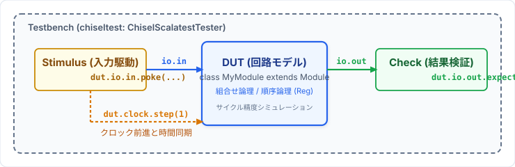
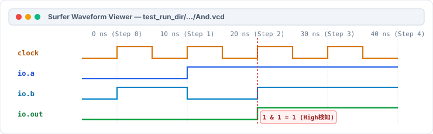

# 第0回: ハードウェアシミュレーションと検証
### 〜chiseltestとSurferによるテスト駆動ハードウェア設計〜

<br>

- **資料作成者**: Hideaki YANAGISAWA
- **講義時間**: 60分
- **対象**: デジタル論理回路基礎習得者
- **本日のアジェンダ**:
  1. デジタルシステム設計における「検証（Verification）」の重要性
  2. ハードウェアシミュレーションの基本概念とツールチェーン
  3. テストベンチの構造（DUTとテスターの分離）
  4. `chiseltest` の基本API（`poke`, `step`, `expect`, `peek`）
  5. 2入力ANDゲートのテストベンチ実装例
  6. **テスト処理のカプセル化（ヘルパーメソッドとテーブル駆動テスト）**
  7. `sbt test` によるテスト実行とテスト失敗時の解析
  8. `WriteVcdAnnotation` によるVCD波形ダンプの生成
  9. 波形ビュワー Surfer を用いたタイミング検証
  10. 本日の演習（Lab00: 環境確認とシミュレーション体験）

<!-- Note:
受講生の皆さん、「Computer System Laboratory」へようこそ。
本授業は全8回を通じて、現代のハードウェア記述言語Chiselを用いてプロセッサのコア要素を設計・実装していきます。
本格的な回路設計に入る前に、本日の第0回では、ハードウェア開発で最も多くの工数を占める「シミュレーションと検証（Verification）」の基盤技術を学びます。
回路を記述するだけでなく、それが仕様通りに動作することを論理シミュレーションで厳密に確かめ、不具合があれば波形から原因を突き止める一連のサイクルをマスターしていただきます。
講義は60分、その後の演習は90分の構成です。
-->

---

## 1. ハードウェア開発における「検証」の決定的役割

### 実機製造（テープアウトやFPGA書き込み）の前にバグをゼロにする
- ソフトウェアは配布後でもパッチ適用が可能ですが、LSI（ASIC）は一度製造すると物理的な修正が不可能であり、数億円規模の損失となります。
- FPGAであっても、内部信号を直接プローブ（オシロスコープ等で測定）することは極めて困難です。

<div class="box">
<b>現代のハードウェア設計工数の約 70% は「検証（Verification）」に費やされる</b><br>
仕様通りの回路を書くこと以上に、あらゆる入力パターンやエッジケースに対して正しく動作することを自動テストで証明する能力がエンジニアに要求されます。
</div>

### テスト自動化の恩恵
- 仕様変更やリファクタリング時に、以前の機能が壊れていないか即座に確認可能（リグレッションテスト）。
- 合否（Pass/Fail）をコンピュータが自動判定し、人間の目視確認ミスを排除。

<!-- Note:
ハードウェア開発における検証の重要性です。
昔の電子工作のように「基板を作って動かしてみて、動かなければテスターで測る」という手法は、数百万〜数十億トランジスタの大規模集積回路では全く通用しません。
チップを製造する前、あるいはFPGAに書き込む前に、コンピュータ上のシミュレータで論理の完全性を100%証明しておく必要があります。
本演習でも「テストを通らない回路は未完成」というエンジニアリング標準を貫きます。
-->

---

## 2. ハードウェアシミュレーションの動作概念

### ソフトウェア実行とハードウェアシミュレーションの違い
- **ソフトウェア（CやJava）**: CPUが1命令ずつシーケンシャル（逐次的）に実行する。
- **ハードウェア（Chiselの回路）**: すべてのゲートや配線が**空間的に並列（Concurrent）**に常時動作する。

<p align="center">
  
</p>

### サイクル精度（Cycle-Accurate）シミュレーション
- シミュレータは、クロックの立ち上がりエッジごとに回路全体の信号状態を数学的に計算し、更新する。
- 回路の物理的な時間遅延を離散的な「クロックサイクル（ステップ）」としてモデル化する。

<!-- Note:
シミュレーションの原理です。
ハードウェアはすべてのゲートが同時に電気信号を流しています。
ソフトウェアのプログラムのように上から下へ順番に走るわけではありません。
シミュレータは、クロックの刻みごとに「すべてのレジスタの次の値」と「すべての組合せ回路の出力」を計算し、仮想的に回路を動作させます。
これをサイクル精度シミュレーションと呼びます。
-->

---

## 3. 開発・検証環境のツールチェーン構成

本講義で使用する Chisel 開発環境の連携構造：

```
 [ 設計コード (MyModule.scala) ]    [ テストコード (MyModuletb.scala) ]
               │                                      │
               └──────────────┬───────────────────────┘
                              ▼
                     [ sbt (Build Tool) ]
                              │
               ┌──────────────┴──────────────┐
               ▼                             ▼
        [ Scala コンパイラ ]           [ chiseltest ]
        （構文解析・型検査）         （テストハーネス実行）
               │                             │
               ▼                             ▼
     [ ハードウェア生成 ]          [ シミュレーション実行 ]
     (emitVerilog 等)             (Treadle / Verilator)
                                             │
                                             ▼
                                   [ VCD波形ファイル生成 ]
                                             │
                                             ▼
                                  [ Surfer (波形ビュワー) ]
```

<!-- Note:
開発環境のツールチェーン全体像です。
ChiselはScalaのDSL（ドメイン特化言語）として実装されています。
ビルドツールである sbt（Scala Build Tool）が、回路コードとテストコードをコンパイルし、chiseltest を起動します。
chiseltest は高速なシミュレーションエンジン（Treadle や Verilator）をバックエンドとして呼び出し、回路を動かして波形（VCD）を生成します。
受講者は複雑なツール連携を意識せず、`sbt test` という単一のコマンドでこの全工程を実行できます。
-->

---

## 4. テストベンチ (Testbench) の構造とDUT

テスト回路は、**「テスト対象回路（DUT）」**と**「テスター（刺激生成・検査器）」**に明確に分離されます。

### DUT (Device Under Test)
- 設計者が実装した回路モジュールそのもの（例: `And`, `FullAdder`, `Counter`）。
- 実機製造される対象であり、テスト用の余計な端子や論理を含めてはならない。

### テストベンチ (Testbench)
- DUTを内部に実体化し、外部からピンを通じて「入力信号を印加」し、「出力信号を検査」するプログラム。
- ハードウェアとして合成されるものではなく、ホストPC上で動作する検証コード。

<div class="box">
<b>テストベンチの3大責務</b><br>
1. <b>Stimulus（刺激）</b>: 入力ポートへテストパターンを注入する。<br>
2. <b>Synchronization（同期）</b>: クロックを進めて回路状態を遷移させる。<br>
3. <b>Checking（検証）</b>: 出力ポートの値が期待値と合致しているかを自動検査する。
</div>

<!-- Note:
DUTとテストベンチの役割分担です。
DUTとは Device Under Test（テスト対象デバイス）の略称で、業界共通の専門用語です。
テストベンチは、DUTというブラックボックスの外側から信号線を繋ぎ、テスト信号を流し込んで出力をチェックする計測器の役割を果たします。
回路本体とテストコードを混同せず、互いに独立したファイルとして管理することが設計の基本です。
-->

---

## 5. `chiseltest` の基本骨格

Chisel公式のテストフレームワーク `chiseltest` と `scalatest` を用いた標準構造：

```scala
import chisel3._
import chiseltest._
import org.scalatest.flatspec.AnyFlatSpec

class MyModuleTest extends AnyFlatSpec with ChiselScalatestTester {
  behavior of "MyModule"

  it should "correctly compute the expected output" in {
    test(new MyModule) { dut =>
      // ここにテストシナリオを記述する
    }
  }
}
```

- **`AnyFlatSpec`**: テスト仕様を自然言語に近い形式（`it should ... in`）で記述するScalaTestのスタイル。
- **`ChiselScalatestTester`**: Chiselの回路をテストするための拡張機能をミックスイン。
- **`test(new MyModule) { dut => ... }`**: 指定したモジュールをシミュレータ上に展開し、その入出力ハンドルを `dut` 変数として提供。

<!-- Note:
chiseltest のコードの骨格です。
ScalaTest というScalaの標準的なテストライブラリの上に、chiseltest が構築されています。
`test(new MyModule) { dut => ... }` というブロックを書くことで、シミュレーションエンジンが自動的に初期化され、`dut` を通じて回路の全入出力ピンにアクセスできるようになります。
ブロックを抜けるとシミュレータは安全に終了します。
-->

---

## 6. 入力信号の駆動: `poke`

DUTの入力ポートに信号値をセット（印加）するには、**`poke`** メソッドを使用します。

```scala
// 1ビット信号の印加
dut.io.a.poke(true.B)
dut.io.b.poke(false.B)

// 符号なし整数 (UInt) の印加
dut.io.data.poke(42.U)
dut.io.addr.poke(3.U(4.W))
```

### 工学的注意点
- **入力ポートのみに適用**: 出力ポートや内部Wireに `poke` することはできません（シミュレーション時エラー）。
- **型の整合性**: `Bool` のポートには `true.B` / `false.B`、`UInt` のポートには `.U` を与えます。
- **即時反映**: `poke` された値は、即座に入力ピンへ伝達され、組合せ回路を通して出力ノードへ伝搬します。

<!-- Note:
poke の解説です。
英語の poke は「突く、差し込む」という意味です。
ICテスターのプローブピンを回路の入力足に当てて、電圧（High/Low）を印加する動作に相当します。
`dut.io.a.poke(true.B)` と書くだけで、回路の入力ポート a に論理1が供給されます。
型安全性が保証されているため、型やビット幅の異なる値を誤って poke しようとするとコンパイル段階で検出されます。
-->

---

## 7. 時間の進行: `step(n)`

クロック同期回路（順序回路）において、時間を進めるには **`step`** メソッドを使用します。

```scala
// 1クロックサイクル進める
dut.clock.step(1)

// 10クロックサイクル進める
dut.clock.step(10)
```

### `step` の内部動作メカニズム
1. 現在のレジスタ値と入力信号から、次状態を計算。
2. クロック信号を `Low` $\to$ `High`（立ち上がりエッジ）へ遷移させる。
3. すべてのフリップフロップ（`Reg`, `RegInit`）が一斉に新しい値へ更新される。
4. 組合せ回路の出力が新たな安定状態へと収束する。

<div class="box">
<b>組合せ回路における <code>step</code></b><br>
クロックを持たない純粋な組合せ回路でも、波形ファイル（VCD）上で時間軸を進めて各テストパターンの変化を可視化するために <code>step(1)</code> を呼び出すのが定石です。
</div>

<!-- Note:
step の仕組みです。
step(1) を呼ぶと、仮想的なクロックが1周期分カチッと進みます。
レジスタの値が更新され、回路全体が次のクロックサイクルの状態に移行します。
組合せ回路の場合、step を呼ばなくても論理的には即座に出力が変わりますが、波形ビュワーで時間軸に沿って信号変化を綺麗に並べるために、1テストケースごとに step(1) を呼ぶのが標準的な作法です。
-->

---

## 8. 出力結果の自動検証: `expect`

回路の出力ポートが、設計仕様通りの論理値を出力しているかを検証するには **`expect`** を使用します。

```scala
// 出力の期待値検査
dut.io.out.expect(true.B)
dut.io.result.expect(15.U)
```

### `expect` の判定メカニズム
- 回路の現在出力が指定した期待値と**完全一致すれば合格（何も起きず次の処理へ進む）**。
- 一致しない場合は、即座に **`TestFailedException`** がスローされ、テストが失敗（赤字でエラー詳細が表示される）。

### 値の読み出し: `peek` / `peekInt()`
期待値比較を行わず、コンソールに値を出力して目視デバッグしたい場合は `peek` を使用：
```scala
val currentVal = dut.io.out.peekInt() // BigInt として取得
println(s"Current output is: $currentVal")
```

<!-- Note:
expect と peek です。
expect（期待する）は自動テストの心臓部です。
もし出力が期待と1ビットでも食い違っていれば、即座にテストを停止し、何サイクル目に何という値が期待されていたのに実際は何が出たかを克明に報告してくれます。
人間がプリント文を目で追いかける必要はありません。
peek（覗き見する）は、シミュレーション中の信号の生の値を数値として取り出したいときに使います。
-->

---

## 9. 実践例: 2入力ANDゲートの完全テストベンチ

真理値表（4パターン）を網羅的に検証するテストベンチ（Lab00の `Andtb.scala`）：

```scala
class Andtb extends AnyFlatSpec with ChiselScalatestTester {
  it should "correctly implement an And gate" in {
    test(new And).withAnnotations(Seq(WriteVcdAnnotation)) { dut =>
      // パターン1: 0 & 0 = 0
      dut.io.a.poke(0.U); dut.io.b.poke(0.U)
      step(1); dut.io.out.expect(0.U)

      // パターン2: 0 & 1 = 0
      dut.io.a.poke(0.U); dut.io.b.poke(1.U)
      step(1); dut.io.out.expect(0.U)

      // パターン3: 1 & 0 = 0
      dut.io.a.poke(1.U); dut.io.b.poke(0.U)
      step(1); dut.io.out.expect(0.U)

      // パターン4: 1 & 1 = 1
      dut.io.a.poke(1.U); dut.io.b.poke(1.U)
      step(1); dut.io.out.expect(1.U)
    }
  }
}
```

<!-- Note:
ANDゲートの完全なテストベンチコードです。
2入力ANDゲートの真理値表は 2^2 = 4通りです。
それぞれのパターンについて、a と b を poke し、step(1) で時間を1目盛り進め、expect で out が正しいかを検証しています。
この4つのテストをすべて通過したとき初めて、「このAND回路は100%正しい」と保証されます。
-->

---

## 10. テスト処理のカプセル化（ヘルパーメソッドの定義）

テストケースごとに `poke` $\to$ `step` $\to$ `expect` $\to$ `println` をコピペするとコードが冗長化する。
DUTと入出力値を引数に取る**ヘルパーメソッド**を定義して検証処理を1箇所に集約する。

```scala
def testStep(dut: And, a: Int, b: Int, expected: Int): Unit = {
  // 1. 入力信号を駆動 (poke)
  dut.io.a.poke(a.U)
  dut.io.b.poke(b.U)

  // 2. クロックを1サイクル進める (step)
  dut.clock.step(1)

  // 3. 実際の出力取得 (peek) と期待値検証 (expect)
  val actual = dut.io.out.peekInt().toInt
  dut.io.out.expect(expected.U)

  // 4. フォーマット表示 (println)
  val tag = if (actual == expected) "[PASS]" else "[FAIL]"
  println(f"$tag a=$a, b=$b => out=$actual (expected=$expected)")
}
```

<!-- Note:
テストコードのリファクタリング手法です。
テストケースが増えてくると、同じような poke や expect のコードが何十行も並んでしまい、見通しが悪くなります。
そこで、DUT の参照と入力値、そして期待値を引数に受け取る関数 `testStep` を定義します。
関数の中で信号を印加し、1ステップ進め、実測値を取得して expect で合否判定を行い、整形したログを出力します。
これにより、テストの「実行ロジック」と「テストデータ」を綺麗に分離できます。
-->

---

## 11. ヘルパーメソッドの活用とテーブル駆動テスト

### 1. メソッド呼び出しによるスッキリした記述
```scala
it should "correctly compute all patterns" in {
  test(new And).withAnnotations(Seq(WriteVcdAnnotation)) { dut =>
    testStep(dut, a = 0, b = 0, expected = 0)
    testStep(dut, a = 0, b = 1, expected = 0)
    testStep(dut, a = 1, b = 0, expected = 0)
    testStep(dut, a = 1, b = 1, expected = 1)
  }
}
```

### 2. 真理値表ループ（テーブル駆動テスト）への発展
```scala
val truthTable = Seq(
  (0, 0, 0), (0, 1, 0), (1, 0, 0), (1, 1, 1)
)
truthTable.foreach { case (a, b, exp) =>
  testStep(dut, a, b, exp)
}
```
- テストパターンの追加・変更がデータ配列を書き換えるだけで完結！

<!-- Note:
ヘルパーメソッドの呼び出し例とテーブル駆動テストです。
テスト本体がたった4行で書けるようになり、入力と期待値の対応が一目で分かります。
さらに一歩進めて、真理値表を Scala のリスト（Seq）として定義しておけば、foreach で回すだけで全パターンを一括実行できます。
第1回以降の加算器やALU、デコーダなど、入力パターンが多い回路をテストする際に極めて強力な武器になります。
-->

---

## 12. `sbt` によるシミュレーション実行作法

ターミナルから `sbt` コマンドでテストスイートを実行します。

### 1. 全テストの一括実行
```bash
$ sbt test
```
- プロジェクト内のすべてのテストクラス（`*tb.scala`）を自動探索して順次実行。

### 2. 特定のテストベンチのみを実行（推奨・高速）
```bash
$ sbt "testOnly Andtb"
```
- 編集中のモジュールに関連するテストベンチだけをピンポイントで即座に再実行できるため、開発サイクルが高速化します。

### 3. ハードウェア記述のVerilogコード生成
```bash
$ sbt run
```
- シミュレーションではなく、実機合成用のハードウェア定義コード（`.sv` / `.v`）を出力。

<!-- Note:
テストの実行手順です。
ターミナルで課題フォルダに入り、`sbt test` と打つだけでコンパイルからシミュレーション、結果集計までが自動で行われます。
課題が進んでテストクラスが増えてくると全体実行に時間がかかるようになるため、`sbt "testOnly クラス名"` で今作っている回路だけを素早くテストする習慣を身につけておくと開発が極めてスムーズになります。
-->

---

## 13. テスト実行ログの読み方（成功時）

テストが正常に完了した際の端末出力：

```text
[info] compiling 1 Scala source to .../target/scala-2.13/classes ...
[info] done compiling
[info] compiling 1 Scala source to .../target/scala-2.13/test-classes ...
[info] done compiling
[info] Andtb:
[info] - should correctly implement an And gate
[info] Run completed in 420 milliseconds.
[info] Total number of tests run: 1
[info] Suites: completed 1, aborted 0
[info] Tests: succeeded 1, failed 0, canceled 0, ignored 0, pending 0
[info] All tests passed.
[success] Total time: 3 s, completed ...
```

- **`- should correctly implement an And gate`**: 各テスト項目がパスしたことを示す。
- **`All tests passed.`**: 全テストスイートの全項目が合格（グリーン）。
- 実行時間は数百ミリ秒程度であり、極めて高速に検証が完了する。

<!-- Note:
成功時のログ画面です。
Scalaのコンパイルが行われた後、テストが実行され、緑色の文字で「All tests passed」と表示されます。
このメッセージが出れば、テストケースで定義された全条件を満たしていることになります。
-->

---

## 14. テスト失敗時のエラーメッセージ解析

回路にバグ（論理誤り）が存在する場合、`chiseltest` は詳細な診断情報を出力します。

```text
[info] Andtb:
[info] - should correctly implement an And gate *** FAILED ***
[info]   In step 4: io_out=0 (0x0) did not equal expected=1 (0x1) at (Andtb.scala:21)
[info] Run completed in 380 milliseconds.
[info] Total number of tests run: 1
[info] Suites: completed 1, aborted 0
[info] Tests: succeeded 0, failed 1, canceled 0, ignored 0, pending 0
[info] *** 1 TEST FAILED ***
[error] Failed tests:
[error] 	Andtb
[error] (Test / test) sbt.TestsFailedException: Tests unsuccessful
```

### 診断情報の着眼点
1. **`In step 4`**: シミュレーション開始から 4 ステップ目（クロックサイクル）で不一致が発生。
2. **`io_out=0 did not equal expected=1`**: 実際の回路出力は `0` だったが、仕様では `1` が期待されていた。
3. **`at (Andtb.scala:21)`**: テストベンチの21行目のアサーションで失敗したことを特定。

<!-- Note:
テスト失敗時の画面です。
プログラミングや回路設計において、エラーメッセージは「宝の山」です。
単に「テストが落ちた」と落胆するのではなく、メッセージを1行ずつ読み解きます。
この例では、「4ステップ目で、出力が期待値1のはずなのに0だった。場所はAndtb.scalaの21行目」と明確に原因と箇所が書かれています。
これにより、入力が 1, 1 のときの論理にバグがあることが瞬時に特定できます。
-->

---

## 15. なぜ「波形解析」が必要なのか？

テキストのログ情報（合格/不合格）だけでは不十分なケース：

```
クロック:     _/~~\__/~~\__/~~\__/~~\__/~~\_
入力信号 a:   ______/‾‾‾‾‾‾‾‾\______________
入力信号 b:   ____________/‾‾‾‾‾‾‾‾\________
出力 out:     ____________/‾‾‾‾\____________  <── 一瞬だけ立ち上がるパルス
```

1. **過渡現象やグリッチの発見**:
   - 信号が切り替わる瞬間の一瞬のヒゲ（グリッチ）や不正なハザードは、文字ログでは見逃しやすい。
2. **多ビットバスの相関確認**:
   - カウンタ値、アドレス、データバス、制御イネーブルが「何サイクル目にどう連動しているか」を直感的に把握できる。
3. **複雑な順序回路・FSMのデバッグ**:
   - 状態レジスタの遷移と制御信号の出力タイミングのズレ（1サイクルの遅れ・進み）を一目で診断可能。

<!-- Note:
波形確認の必要性です。
単体テストの合否判定は自動化できますが、「なぜそのサイクルで想定外の値が出たのか」を人間がデバッグするとき、最も強力な武器になるのが時間軸の波形（オシロスコープの画面）です。
複数の信号が複雑に絡み合うデジタル回路では、波形を見れば「あ、イネーブル信号が1クロック遅れて立ち上がっている」といった原因が数秒で分かります。
-->

---

## 16. VCD波形ダンプの生成 (`WriteVcdAnnotation`)

Chiselでは、テスト実行時にアノテーションを付与するだけで、標準的な波形ファイル（**VCD: Value Change Dump**）を自動生成できます。

```scala
import chiseltest._

test(new And).withAnnotations(Seq(WriteVcdAnnotation)) { dut =>
  // ... テスト実行 ...
}
```

### 生成されるVCDファイルの保存場所
シミュレーションを実行すると、プロジェクト直下の **`test_run_dir/`** に格納されます：

```text
test_run_dir/
└── should_correctly_implement_an_And_gate/
    ├── And.lo.fir     (中間表現 FIRRTL)
    └── And.vcd        <── これが波形データファイル！
```

- `find . -name "*.vcd"` コマンドで即座にパスを確認できます。

<!-- Note:
VCDファイルの生成方法です。
`.withAnnotations(Seq(WriteVcdAnnotation))` をテストの宣言につけるだけです。
これをつけると、シミュレータが動いている間のすべての入出力ピン、内部レジスタ、Wireの電圧変化が `test_run_dir` の中に `.vcd` という業界標準フォーマットのファイルとしてすべて記録されます。
-->

---

## 17. 波形ビュワー Surfer の基本操作

高速・軽量な最新の波形ビュワー **`surfer`** を用いた解析手法。

<p align="center">
  
</p>

### 基本操作フロー
1. **起動**: ターミナルから `surfer &` を実行。
2. **ファイルを開く**: メニューまたはドラッグ＆ドロップで `.vcd` ファイルを読み込む。
3. **信号の配置**: 左側のモジュールツリーから、観測したい信号（`clock`, `io_a`, `io_b`, `io_out` 等）を選択してメインウィンドウへドラッグ。
4. **表示形式の変更**: バス信号（多ビット）を右クリックし、基数（Hexadecimal / Decimal / Binary）を切り替え。

<!-- Note:
Surfer の使い方です。
Rustで書かれた非常に軽快なオープンソースの波形ビュワー Surfer を使用します。
生成された vcd ファイルを開くと、左側に回路の階層ツリーが表示されます。
見たい信号をドラッグして右側のタイムラインエリアに落とすと、クロックに合わせた綺麗なデジタル波形が描画されます。
カーソルを置けば、その時点での各信号の正確な値が確認できます。
-->

---

## 18. テスト駆動ハードウェア開発 (TDD) のワークフロー

本講義シリーズを通じて実践する、プロ仕様の開発サイクル：

```
 ┌─────────────────────────────────────────────────────────┐
 │ 1. 回路仕様の理解 (ポート構成・真理値表・タイミング仕様)   │
 └────────────────────────────┬────────────────────────────┘
                              ▼
 ┌─────────────────────────────────────────────────────────┐
 │ 2. テストベンチの作成 (期待値・エッジケースシナリオ定義)    │
 └────────────────────────────┬────────────────────────────┘
                              ▼
 ┌─────────────────────────────────────────────────────────┐
 │ 3. 回路本体の実装 (Chisel によるハードウェア記述)          │
 └────────────────────────────┬────────────────────────────┘
                              ▼
 ┌─────────────────────────────────────────────────────────┐
 │ 4. sbt test 実行 ───[ PASS ]───> 6. 完成・次の課題へ     │
 └─────────────┬───────────────────────────────────────────┘
          [ FAIL ]
               ▼
 ┌─────────────────────────────────────────────────────────┐
 │ 5. Surfer で波形解析 ──> 原因特定 ──> 回路コードを修正   │
 └─────────────────────────────────────────────────────────┘
```

<!-- Note:
テスト駆動開発（TDD: Test-Driven Development）のサイクルです。
いきなり回路を書き始めるのではなく、まず「どう動くべきか」という仕様からテストベンチを準備します。
そして回路を書き、テストを走らせます。
もし失敗したら、波形ビュワー Surfer を開いてどの信号が間違っているかを特定し、回路を直して再びテストを走らせます。
このサイクルを回すことで、誰が見ても確実に動作する強固なハードウェアを作り上げることができます。
-->

---

## 19. 本日の演習課題 (Lab00: 90分)

本日の演習時間は、受講者各自の開発環境が完全に動作することを確認し、シミュレーションと波形確認の操作に習熟するためのチュートリアルです。

### 演習の目標
1. **環境確認**: JDK 17+, `sbt`, `surfer` が正しくインストールされ、動作することを確認。
2. **テスト実行**: `Lab00` ディレクトリに移動し、`sbt test` を実行して合格（All tests passed）を確認。
3. **ヘルパーメソッドの実装**:
   - `Andtb.scala` に `testStep(dut, a, b, expected)` を定義し、テストコードをリファクタリング。
4. **波形出力と観察**:
   - `And.vcd` を `surfer` で開き、入力 `a`, `b` と出力 `out` の波形を表示。
   - $0 \ \& \ 0 = 0$, $0 \ \& \ 1 = 0$, $1 \ \& \ 0 = 0$, $1 \ \& \ 1 = 1$ の4状態遷移を時間軸上で確認。
5. **意図的なバグ注入テスト（任意）**:
   - `And.scala` の `io.a & io.b` を `io.a | io.b`（OR回路）に変更して `sbt test` を実行。
   - エラーメッセージと Surfer 上の波形がどのように食い違うかを体験し、元の論理に戻す。

<!-- Note:
本日の演習内容です。
第0回は環境セットアップと操作体験がメインです。
Lab00 のフォルダに入り、実際に sbt test を叩いてみてください。
そして先ほど紹介したヘルパーメソッド testStep を Andtb.scala に実装してみましょう。
生成された And.vcd を surfer で開き、マウスで拡大縮小したりカーソルを動かして波形を眺めてみてください。
時間に余裕がある方は、わざとコードを書き換えてエラーを出してみると、エラーメッセージの読み方が非常によく理解できます。
-->

---

## 20. 第0回 まとめ & 第1回への橋渡し

### 本日の最重要ポイント
1. ハードウェア開発の品質と信頼性は、徹底した**自動テストベンチ（検証）**によって担保される。
2. `chiseltest` は、`poke`（入力印加）、`step`（クロック前進）、`expect`（出力自動検証）を提供する。
3. 検証処理を**ヘルパーメソッド**にカプセル化することで、テストコードの保守性と可読性が飛躍的に高まる。
4. `sbt test` により、コンパイルから合否判定までをコマンド一発で自動実行できる。
5. 複雑なタイミングや不具合の解析には、`WriteVcdAnnotation` と **Surfer 波形ビュワー**が不可欠である。

### 次回予告: 第1回「組合せ回路の基礎」
- ブール代数からハードウェア記述言語へのステップアップ
- 有向非巡回グラフ (DAG) と Chisel の型システム (`Bool`, `UInt`)
- 1ビット半加算器・全加算器の設計と多ビット拡張加算 (`+&`)

<!-- Note:
第0回の講義は以上となります。
テストベンチの記述作法、ヘルパーメソッドによるテストのカプセル化、そして波形ビュワーの使い方をマスターできたことで、皆さんはこれからの全8回の実験課題を自律的にデバッグし、進めるための強力な武器を手に入れました。
次回はいよいよ「第1回: 組合せ回路の基礎」に入り、加算器の設計に取り組みます。
それでは演習に移ります。ターミナルを開いて Lab00 の作業を開始してください。
-->
