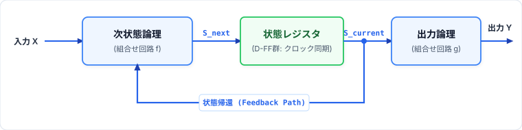
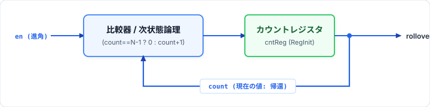
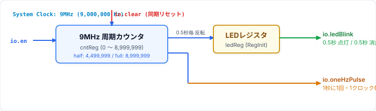
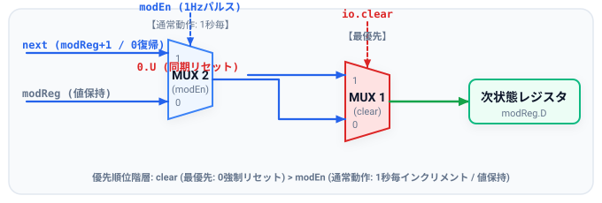
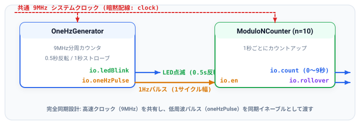
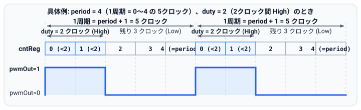
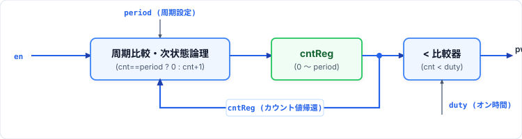

# 第3回: 順序回路と基本カウンタ
### 〜クロック同期設計・1Hzパルス生成とモジュロNカウンタ〜

<br>

- **資料作成者**: Hideaki YANAGISAWA
- **講義時間**: 60分
- **対象**: デジタル論理回路基礎習得者
- **本日のアジェンダ**:
  1. 順序回路の本質（フィードバックと状態記憶）
  2. クロック同期設計の鉄則とメタスタビリティ回避
  3. Chiselにおける暗黙のクロックとリセット
  4. レジスタプリミティブ (`Reg`, `RegInit`, `RegNext`)
  5. カウンタ回路の内部構成（加算器＋レジスタ＋比較器）
  6. 1Hz信号生成・0.5秒LED点滅カウンタ（9MHzクロック分周）
  7. モジュロ$N$カウンタのラップアラウンド論理
  8. 制御信号の優先度設計 (`clear` > `en`) と出力論理の分離
  9. 1秒ごとにカウントアップするモジュロNカウンタの完全同期設計
  10. 本日の演習課題（実機TeCボード配線・動作確認 & 基本2問・確認課題）

<!-- Note:
第3回の講義へようこそ。
第1回・第2回では「組合せ論理回路」を扱ってきました。
今回からはいよいよ、ハードウェアに「記憶」と「時間」の概念を導入する「順序回路（Sequential Circuit）」の世界に入ります。
完全同期設計の原則を学び、9MHzのシステムクロックから0.5秒ごとのLED点滅と1Hzパルスを生成するカウンタ、および汎用的なモジュロNカウンタを設計します。
-->

---

## 1. 順序回路 (Sequential Circuit) の本質

### 組合せ回路との本質的違い
出力ベクトル $\mathbf{Y}$ および次の状態 $\mathbf{S}_{next}$ が、**「現在の入力 $\mathbf{X}$」と「現在の内部状態 $\mathbf{S}_{current}$」の両方**によって決定される。

$$\mathbf{S}_{next} = f(\mathbf{X}, \mathbf{S}_{current})$$
$$\mathbf{Y} = g(\mathbf{X}, \mathbf{S}_{current})$$

<p align="center">
  
</p>

- **記憶性**: 過去の入力履歴の累積が「状態（State）」としてレジスタに保持される。

<!-- Note:
順序回路の基本モデルです。
フリップフロップという記憶素子を挟むことで、初めて「閉ループ（フィードバック）」を安全に組むことができるようになります。
クロックが来るたびに、次状態論理で計算された新しい値がレジスタに取り込まれ、回路の状態が1ステップ進みます。
-->

---

## 2. クロック同期設計 (Synchronous Design) の鉄則

### なぜ同期設計なのか？
回路内の**すべての記憶素子（FF）を単一の共通クロック（System Clock）の立ち上がりエッジ**で同時に駆動する設計手法。

<div class="box">
<b>非同期設計の危険性と同期設計のメリット</b><br>
・<b>非同期回路</b>: ゲート遅延のバラツキによるハザード、グリッチの誤記憶、メタスタビリティの伝播により設計・検証が極めて困難。<br>
・<b>同期設計</b>: クロック周期 $T_{clk}$ 内に組合せ回路の遅延が収まっていれば、途中のグリッチはエッジで完全に遮断され、確実な動作が保証される。
</div>

### セットアップ時間 ($t_{su}$) と ホールド時間 ($t_h$)
- **Setup Violation**: クロックエッジ直前にデータが安定していないと、FFが `0` でも `1` でもない中間電位（**メタスタビリティ**）に陥る。

<!-- Note:
同期設計の重要性です。
組合せ回路の出力には、ゲート遅延の差によって「ヒゲ（グリッチ）」と呼ばれる一瞬の不要なパルスが必ず発生します。
しかし、同期設計であれば、次のクロックエッジが来るまでに信号が安定していれば問題ありません。クロックエッジの瞬間に安定した値だけをサンプリングするため、途中のグリッチは綺麗に消去されます。
-->

---

## 3. Chiselにおける暗黙のクロックとリセット

Chiselでは、同期設計を強力に支援するため、**クロック (`clock`) と同期リセット (`reset`) が全てのモジュールに暗黙（Implicit）に配線**されます。

```scala
class MyModule extends Module {
  val io = IO(new Bundle { ... })
  // ここに clock や reset を手動で宣言・配線する必要はない！
  // Chisel環境が最上位から自動的にグローバルクロックツリーを供給する。
}
```

- **利点**:
  - ポート定義にクロックやリセットをいちいち書く手間が省ける。
  - 配線ミスによるクロックスキューやリセット漏れを構造的に防止。
  - 特殊な非同期クロック境界（CDC）を扱う場合のみ、明示的な Clock を使用。

<!-- Note:
Chiselの非常に優れた設計思想の一つがこの「暗黙のクロックとリセット」です。
一般的な同期回路では、すべてのFFに同じクロックとリセット線を引くのは自明の作業です。
Chiselでは、Moduleを継承するだけで、モジュール全体に自動的に共通のclockとresetが分配されます。
設計者はデータパスと制御論理の記述に100%集中することができます。
-->

---

## 4. Chiselのレジスタ生成: `RegInit`

ハードウェアのDフリップフロップ（D-FF）を生成するには、初期化付きレジスタ `RegInit` を使用します。

```scala
// リセット時に 0.U(8.W) で初期化される8ビットレジスタ
val countReg = RegInit(0.U(8.W))

// リセット時に false.B で初期化される1ビットフラグ
val flagReg  = RegInit(false.B)
```

### クロックエッジごとの更新
レジスタへの代入 `countReg := ...` は、**「次のクロック立ち上がりエッジでレジスタに取り込まれる次状態」**を意味します。

```scala
countReg := countReg + 1.U // 毎クロック1ずつカウントアップ
```

<div class="box">
<b>初期値のない <code>Reg</code> の使用禁止</b><br>
初期値のない <code>Reg(UInt(8.W))</code> は、電源投入時の値が未定義 (X) になります。実機での信頼性を保証するため、必ず <code>RegInit</code> でリセット初期値を明示してください。
</div>

<!-- Note:
レジスタの記述法です。
RegInit は「リセット時の初期値」を指定してD-FFを生成する構文です。
countReg := countReg + 1.U と書くと、ソフトウェアのループ変数のように見えますが、実際には「現在のレジスタ出力 countReg を加算器に通し、その出力をレジスタのD入力に接続している」というフィードバックループ回路を意味します。
-->

---

## 5. その他のレジスタ構文: `RegNext` とパイプライン

### `RegNext`: 1クロック遅延のショートカット
入力信号を1クロック遅延（サンプリング）させたい場合、`RegNext` が便利です。

```scala
// dataIn を1クロック遅延させた信号
val delayData = RegNext(io.dataIn, 0.U(8.W))
```

- 第二引数にリセット時の初期値を指定可能。

### パイプラインレジスタの役割
```
 [組合せ論理 A] ──> [ RegNext ] ──> [組合せ論理 B]
```
- 長大な組合せ論理の間にレジスタを挟むことで、クリティカルパスを半分に分割し、動作クロック周波数を2倍に引き上げることができる。

<!-- Note:
RegNext の紹介です。
信号を1クロックだけ遅らせたいとき、パイプラインステージを挿入したいときに1行で記述できます。
後ほど第6回の確認課題でパイプラインALUを作る際にも大活躍します。
-->

---

## 6. カウンタ回路 (Counter) の内部アーキテクチャ

カウンタは、クロックに同期して特定の数列を規則的に巡回する順序回路。

<p align="center">
  
</p>

### カウンタの3大構成要素
1. **状態レジスタ (`RegInit`)**: 現在のカウント値を保持するD-FF群。
2. **インクリメンタ（加算器）**: `count + 1.U` を計算する組合せ回路。
3. **終端比較器 (Comparator)**: 最大値（例: $N-1$）に達したことを検出し、次サイクルで `0` に戻す論理。

<!-- Note:
カウンタの内部ブロック図です。
カウンタは一見単純ですが、順序回路の基本要素がすべて詰まっています。
加算器が次の値を計算し、比較器が上限を監視し、クロックが来るたびにレジスタが値を更新します。
この構造を理解することが、すべての複雑なFSMや制御回路を理解する鍵となります。
-->

---

## 7. 実機応用: 9MHzクロック分周による1Hz生成 & 0.5秒LED点滅

FPGA実機等では、水晶発振器から供給される高周波クロック（例: **$9\text{MHz} = 9,000,000\text{Hz}$**）から、人間が視認可能な $1\text{Hz}$（1秒周期）信号を生成します。

### カウンタによる時間生成の原理
- **1秒（全周期）**: $9,000,000$ クロックサイクル
- **0.5秒（半周期）**: $4,500,000$ クロックサイクル
- ビット幅計算: $\lceil \log_2(9,000,000) \rceil = 24$ ビット（`UInt(24.W)`）

```scala
val halfPeriod = clkFreq / 2 // 4,500,000 (0.5秒)
val fullPeriod = clkFreq     // 9,000,000 (1.0秒)
```

- **0.5秒点灯 / 0.5秒消灯**: 半周期および全周期到達時にLEDレジスタ（`ledReg`）を反転（トグル）。
- **同期1秒パルス**: 全周期満了時に**1クロック幅だけ High** となる `oneHzPulse` を出力。

<!-- Note:
実機回路で最も基本的かつ重要な「クロック分周による秒パルス生成とLED点滅」です。
9MHzのクロックが入ってくるとき、0.5秒ごとにLEDを反転させれば、1秒間に1回チカチカと点滅するLED回路が作れます。
また、後段の時計回路などの同期イネーブルとして使える「1クロック幅の1Hzパルス」も同時に生成します。
パラメータ化しておくことで、シミュレーション時は小さな値（例えば10サイクル）で瞬時にテストできます。
-->

---

## 8. 1Hz生成・LED点滅カウンタの回路アーキテクチャ

<p align="center">
  
</p>

### ハードウェア記述のポイント（カウンタとLED制御の独立化）
```scala
// 1. カウンタ更新論理（0 〜 fullPeriod-1 を周期カウント）
when(io.clear) {
  cntReg := 0.U
}.elsewhen(io.en) {
  when(cntReg === (fullPeriod - 1).U) {
    cntReg := 0.U
  }.otherwise {
    cntReg := cntReg + 1.U
  }
}

// 2. LED点滅レジスタ更新論理（0.5秒ごとに反転）
when(io.clear) {
  ledReg := false.B
}.elsewhen(io.en) {
  when(cntReg === (halfPeriod - 1).U || cntReg === (fullPeriod - 1).U) {
    ledReg := !ledReg
  }
}

// 3. 出力信号の接続
io.ledBlink   := ledReg
io.oneHzPulse := io.en && (cntReg === (fullPeriod - 1).U)
```

<!-- Note:
回路ブロック図とChiselコードの対比です。
設計の重要なポイントは「カウンタの巡回論理」と「LEDレジスタの反転論理」を明確に分けて記述することです。
まずカウンタ cntReg は、0から fullPeriod-1（8,999,999）までを数えて0に戻る独立した周期カウンタとして記述します。
そして ledReg は、cntReg が halfPeriod-1（4,499,999）および fullPeriod-1 に達した瞬間に反転（トグル）させます。
このように各レジスタの更新条件を独立させることで、回路構造がブロック図と直接一致し、可読性と保守性が大幅に向上します。
-->

---

## 9. モジュロ $N$ カウンタ (Modulo-$N$ Counter)

$0$ から $N-1$ までの $N$ 個の状態を巡回するカウンタ。

### ラップアラウンド（巡回）の論理条件
カウンタが $N-1$ に達したとき、次のクロックで `0` に戻らなければならない。

```scala
when(cntReg === (n - 1).U) {
  cntReg := 0.U
}.otherwise {
  cntReg := cntReg + 1.U
}
```

<div class="box">
<b>工学的注意: 比較演算子の選定</b><br>
大小比較 <code>cntReg &gt;= (n - 1).U</code> よりも、完全一致比較 <code>cntReg === (n - 1).U</code> の方が、合成されるコンパレータ回路のゲート段数が少なく高速です（ただしオーバーシュート保護が不要な場合）。
</div>

<!-- Note:
モジュロNカウンタの設計です。
0から数え始めるため、N進カウンタの最大値は N-1 です。例えば10進カウンタなら 0〜9 を数えます。
したがって、リセット判定は `=== (n - 1).U` になります。
初心者がよく `=== n.U` と書いてしまい、N+1進カウンタになってしまうミスが多いので注意してください。
-->

---

## 10. 制御信号の優先度設計 (`clear` > `en`)

実用的なカウンタには複数の制御入力（`clear`, `en`）が存在します。
これらが同時にアサートされた場合の優先順位を明確に定義しなければなりません。

### 安全最優先の優先度アーキテクチャ
$$\mathbf{clear\ (最優先:\ 0強制リセット)} > \mathbf{modEn\ (通常動作:\ 1秒毎インクリメント/保持)}$$

<p align="center"></p>

- **同期クリア (`clear`)**: どのような状態でも強制的に 0 に初期化する（安全装置・最優先）。
- **1秒イネーブル (`modEn`)**: 9MHz分周で1秒に1回だけ有効化され、カウントを +1（通常動作）。
- **設計の勘所**: 複雑な `load` 信号を排し、`clear` と `en` の2段階に絞り込むことで、マルチプレクサ段数を削減しクリティカルパスを短縮。

<!-- Note:
制御信号の優先順位です。
ハードウェア制御において、リセットやクリアは安全に関わるため常に最優先されます。
通常動作であるカウントアップはクリアが非アクティブな時のみ許可されます。
複雑な load 信号をあえて省くことで、回路規模を抑え、より高速かつ安定した動作を実現できます。
-->

---

## 11. 1秒ごとにカウントアップするモジュロ $N$ カウンタのChisel記述

### ハードウェア記述のポイント（更新論理と出力論理の明確な分離）

```scala
class ModuloNCounter(val n: Int = 10, val width: Int = 4, val clkFreq: Int = 9000000) extends Module {
  val io = IO(new Bundle {
    val en       = Input(Bool())         // カウントイネーブル
    val clear    = Input(Bool())         // 同期クリア (最優先で 0 にリセット)
    val count    = Output(UInt(width.W)) // カウント出力 (実機LED向け負論理)
    val runLED   = Output(Bool())        // 動作確認用LED (0.5秒反転、負論理)
  })

  // 1. 9MHz分周カウンタ更新論理（0 〜 fullPeriod-1 を周期カウント）
  when(io.clear) { cntReg := 0.U }.elsewhen(io.en) {
    when(cntReg === (clkFreq - 1).U) { cntReg := 0.U }.otherwise { cntReg := cntReg + 1.U }
  }
  modEn := io.en && (cntReg === (fullPeriod - 1).U) // 1秒ストローブ

  // 2. モジュロN更新論理 (clear > modEn の優先度で 0 〜 n-1 をカウント)
  when(io.clear) { modReg := 0.U }.elsewhen(modEn) {
    when(modReg === (n - 1).U) { modReg := 0.U }.otherwise { modReg := modReg + 1.U }
  }

  // 3. LED点滅更新論理 & 4. 出力論理（負論理で実機LEDへ出力）
  io.runLED := ~ledReg
  io.count  := ~modReg
}
```

<!-- Note:
モジュロNカウンタの完全な実装です。
Slide 8の OneHzGenerator と同様、「カウンタ更新論理」と「出力論理」を明確に分離して記述します。
内部で9MHzから1秒ストローブ modEn を生成し、そのパルスによって modReg を 0から n-1 まで数えさせます。
また、実機FPGAボードのLEDは「0で点灯、1で消灯」の負論理回路となっているため、出力段で反転（~）させて接続します。
-->

---

## 12. 1秒ストローブと実機LED負論理駆動のアーキテクチャ

<p align="center"></p>

### クロック同期設計の真髄
- **単一クロック領域**: 回路全体が単一の 9MHz システムクロック（暗黙の `clock`）で完全同期駆動。
- **リップルクロックの撲滅**: 「低速クロックを作ってFFのクロックに入れる」のではなく、「**高速クロック下でストローブパルス `modEn` を同期イネーブルとして渡す**」のが現代デジタル回路の鉄則。
- **負論理LED駆動**: 出力ポート `count` と `runLED` にビット反転 `~` を適用し、ボード上のアクティブLow LEDを直接ドライブ。

<!-- Note:
モジュール内部ブロック図の解説です。
一つのモジュール内で、9MHz分周器が時を刻み、1秒に1回だけ modEn がアサートされます。
モジュロNカウンタはそのパルスを受け取った瞬間にだけ値をインクリメントします。
これにより、クロックスキューの心配が一切ない、完全同期の1秒時計カウンタが実現します。
-->

---

## 13. `modEn` パルスとカウント更新のタイミング設計

### ストローブパルスによる同期更新
`modEn` は、分周カウンタ `cntReg` が満了値に達している**その1クロックサイクル中のみ**アサートされます。

```
CLK      : ───┐   ┌───┐   ┌───┐   ┌───┐   ┌───┐   ┌───
              └───┘   └───┘   └───┘   └───┘   └───┘   
cntReg   : ──X F-2 X      F-1        X    0    X   1   X  (F = fullPeriod)
modEn    : ─────────────────|‾‾‾‾‾‾‾‾‾|───────────────  (1サイクルのみHigh)
modReg   : ────────X        N-2       X      N-1      X  (次のエッジで更新)
```

- **安全確実な状態遷移**: クロック立ち上がりで `modEn` がサンプリングされ、`modReg` が確実に 1 カウントアップ。
- **保持動作**: `modEn` が Low の期間（大多数のクロックサイクル）は、レジスタは安全に値を保持。

<!-- Note:
タイミングチャートによる解説です。
9,000,000サイクルに1度だけ、1クロック幅の modEn パルスが立ちます。
次のクロックエッジで、自分自身の分周カウンタは0に戻り、同時にモジュロレジスタが1つインクリメントされます。
この1サイクルの重複が、完全同期カウントアップを実現する秘訣です。
-->

---

## 14. 発展課題: パルス幅変調 (PWM) 発生器 (`PwmGenerator`)

### PWM (Pulse Width Modulation) とは
一定の周期の中でパルスを **High (ON) にする時間幅**を変化させ、LEDの明るさやモータの回転速度を滑らかに制御する方式。

<p align="center"></p>

### 各入出力ピンが表す意味
- **`period` (8ビット入力: カウンタ上限値)**: `cntReg` が **`0` から `period` まで**数えて `0` に戻る。したがって **1周期のクロック数は `period + 1` サイクル**（例: `period = 4` なら `0, 1, 2, 3, 4` の **5クロック周期**）。
- **`duty` (8ビット入力: Highにするクロック数)**: 1周期のうち **`cntReg < duty` の期間（`duty` クロック間）だけ High** を出力（例: `period = 4`, `duty = 2` なら `cntReg = 0, 1` の **2クロック間 High** $\implies$ デューティ比 $2/5 = 40\%$）。
- **`en` (1ビット入力: 動作許可)** / **`pwmOut` (1ビット出力: PWMパルス波形)**

<!-- Note:
確認課題で作成するPWMパルス発生器の解説です。
入力信号の意味をしっかり押さえましょう。
まず period は「内部カウンタ cntReg がどこまで数えたら0に戻るか」という上限値です。0から数え始めるので、例えば period に 4 を入力すると、カウンタは 0, 1, 2, 3, 4 と数えて0に戻り、1周期は「period + 1 = 5クロック」になります。
次に duty は「1周期のうち何クロックの間だけ出力をHigh（ON）にするか」という閾値です。cntReg < duty の間だけ pwmOut を true.B にします。例えば duty に 2 を入れると、cntReg が 0 と 1 の2クロックの間だけ High になり、2, 3, 4 の3クロックの間は Low になります。これで 2/5 = 40% のデューティ比が作れます。
-->

---

## 15. PWM発生器の回路構成・動作仕様 & コーナーケース

<p align="center">
  
</p>

### 回路の2大動作ルールとコーナーケース
1. **周期カウンタ (`cntReg`) の更新**:
   - `io.en === true.B` のとき、`cntReg >= io.period`（または上限 `periodMax.U`）に達したら `0.U` に戻し、それ以外は `cntReg + 1.U`。
   - `io.en === false.B`（停止時）は `cntReg := 0.U` にリセット。
2. **比較器による出力 (`io.pwmOut`) と境界条件**:
   - **`io.pwmOut := io.en && (cntReg < io.duty) && (io.duty > 0.U)`**
   - **`duty == 0` (0%消灯)**: `cntReg < 0` は成立しないため常時 `false.B`。
   - **`duty > period` (100%点灯)**: `0` 〜 `period` の全てで `cntReg < duty` となり常時 `true.B`。
   - **`en == false.B` (無効時)**: モータ等の暴走を防ぐため、即座に出力を `false.B` に遮断。

<!-- Note:
PWM発生器の内部ブロック図と実装仕様です。
回路は「0からperiodまで数える周期カウンタ cntReg」と「cntReg < io.duty を判定する比較器」の2つだけで構成されます。
コーナーケースとして、dutyが0のときは完全消灯（0%）、dutyがperiodより大きい（例えばperiod=4に対してduty=5）のときは常時High（100%）、そしてenがfalseのときはカウンタを0に戻しつつ出力を即座にfalseに落とすように設計します。
-->

---

## 16. 順序回路のデバッグと検証手法

### 波形確認の着眼点
1. **リセット解除直後の挙動**: クロックエッジで正しく `RegInit` の値に初期化されているか。
2. **遷移の1サイクル遅延**: 組合せ回路と違い、入力の変化が出力レジスタに反映されるのは**「次のクロックの立ち上がり」**である。
3. **グリッチ耐性**: 内部の組合せ演算が途中で揺れても、サンプリング点（セットアップ時間前）で静定していれば波形は乱れない。

<!-- Note:
デバッグの心構えです。
受講者が順序回路で最も混乱しやすいのが「1クロックの遅延」です。
入力ピンの信号を変えても、その瞬間に出力レジスタは変わりません。次のクロックエッジが来て初めて値が更新されます。
シミュレータの波形を見る際は、クロックの立ち上がりエッジに縦線を引いて、エッジの前後の値を観察してください。
-->

---

## 17. 本日の演習課題 (90分)

演習は**基本問題（2問）**と**確認課題（1問）**の構成です。

### 基本問題（必須 / 目安50分）
1. **課題1: `OneHzGenerator`** (25分): 1Hz生成・0.5秒LED点滅回路
   - 9MHz（`clkFreq = 9000000`）から0.5秒ごとに `ledBlink` を反転（1Hz点滅）
   - 1秒（全周期満了）時に1クロック幅の同期ストローブパルス `oneHzPulse` を出力
   - TeCボード実機へ書き込み、`RUN_LED` の点滅と `C_LED` の1秒パルス点灯を確認
2. **課題2: `ModuloNCounter`** (25分): 1秒ごとにカウントアップする同期クリア付きモジュロNカウンタ
   - `clear` > `en` の優先度制御（安全で確実な同期クリア）
   - 9MHz分周による1秒ストローブパルス `modEn` の生成
   - カウンタ更新論理と出力論理（`count`, `runLED`）の明確な分離（負論理LED駆動）
   - TeCボード実機へ書き込み、`DATA_LED` の1秒カウントアップ表示を確認

### 確認課題 (目安30分)
- **`PwmGenerator`**:
   - 周期レジスタ `period` とデューティ比レジスタ `duty` の動的制御
   - コーナーケース（0%および100%）の正確なハンドリング

### バッファ (10分)
- ハードウェア論理合成・実機書き込み、テスト実行、質疑応答

<!-- Note:
本日の90分演習の案内です。
まずは課題1として、9MHzのクロックから0.5秒ごとのLED反転信号と1秒パルスを生成する OneHzGenerator を完成させ、TeCボードで動作確認します。
次に課題2として、内部で1秒パルスを作って1秒ごとにカウントアップする ModuloNCounter を作成し、優先度制御と負論理LED出力を実機で確認します。
-->

---

## 18. 実機FPGA (TeCボード) 配線仕様（課題1 & 課題2）

生成された回路を実機TeCボードに書き込んで動作確認を行います。
**今回の回路出力は負論理（0で点灯）のままで接続可能です。**

### 課題1: 1Hz生成回路 (`OneHzGenerator`) 配線仕様
| 信号名 | TeCボード端子 | ピン番号 | 接続・動作説明 |
| :--- | :--- | :---: | :--- |
| `clock` | `CLK_IN` | `P55` | 9MHz オンボードシステムクロック |
| `io.en` | `RUN_SW` | `P16` | カウントイネーブル（PULLUPスイッチ） |
| `io.clear` | `RESET_SW` | `P120` | 同期クリア（PULLUPスイッチ） |
| `io.ledBlink` | `RUN_LED` | `P43` | 0.5秒点灯/0.5秒消灯の1Hz点滅（負論理駆動） |
| `io.oneHzPulse` | `C_LED` | `P46` | 1秒ストローブパルス（1秒に1回パルス点灯） |

### 課題2: モジュロNカウンタ (`ModuloNCounter`) 配線仕様
| 信号名 | TeCボード端子 | ピン番号 | 接続・動作説明 |
| :--- | :--- | :---: | :--- |
| `clock` | `CLK_IN` | `P55` | 9MHz オンボードシステムクロック |
| `io.en` | `RUN_SW` | `P16` | カウントイネーブル（`RUN_SW` オンで計数開始） |
| `io.clear` | `RESET_SW` | `P120` | 同期クリア（`RESET_SW` 押下でカウント0初期化） |
| `io.count[3:0]`| `DATA_LED[3:0]`| `P62, 61, 59, 58`| 4ビットバイナリカウント値表示（負論理点灯） |
| `io.runLED` | `RUN_LED` | `P43` | 動作状態インジケータ（1Hz点滅） |

<!-- Note:
実機TeCボードへの接続仕様です。
課題1の配線では、入力enをRUN_SW、入力clearをRESET_SWに繋ぎます。
出力ledBlinkをRUN_LEDに、出力oneHzPulseをC_LEDに繋ぎます。TeCボードのLEDはカソード側を駆動する負論理（0で点灯）となっており、今回の出力論理のままで正しく点滅します。
課題2の配線では、同様に入力enをRUN_SW、入力clearをRESET_SWに繋ぎ、出力countを4個のDATA_LED、出力runLEDをRUN_LEDに繋ぎます。
RUN_SWをオンにすると、RUN_LEDが点滅しながら1秒ごとにDATA_LEDが0から9まで進むことを確認してください。
-->

---

## 19. 第3回 まとめ & 次回予告

### 本日の重要ポイント
1. 順序回路は「次状態組合せ論理」と「状態保持D-FF」のフィードバック結合である。
2. Chiselは `Module` 内に**暗黙の `clock` と `reset`** を自動配線する。
3. リセット初期値付きレジスタは `RegInit(...)` で生成する。
4. 9MHz等の高周波から時間を作る際は、**カウンタによる分周と同期パルス生成**を行う。
5. モジュロ$N$カウンタは `clear > en` 優先度で設計し、カウンタ更新と出力を分離する。
6. 単一クロック領域で 1Hz ストローブパルスを同期イネーブルとして用いることで、**リップルクロックを完全排除した1秒時計**が実現できる。

### 次回予告: 第4回「RingカウンタとJohnsonカウンタ」
- シフトレジスタの循環構造と1-hot状態遷移
- Johnsonカウンタ（$2N$状態巡回）と反転帰還
- グリッチフリーなグレイコード・カウンタ

<!-- Note:
第3回の講義は以上となります。
高周波クロックからの1秒生成やカウンタの優先度制御は、すべてのデジタルハードウェアエンジニアにとって必須の技術です。
それでは90分の演習に移ります。Lab03の課題に取り組んでください。
-->
