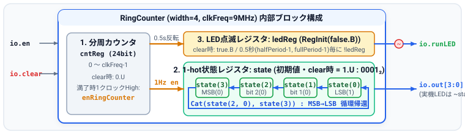
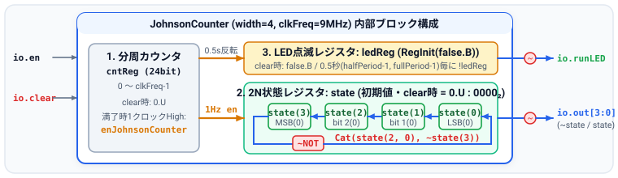
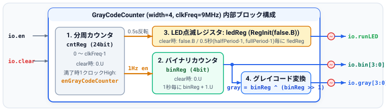

# 第4回: Ring/Johnsonカウンタ 受講者配布資料
**授業名**: Computer System Laboratory | **資料作成者**: Hideaki YANAGISAWA | **講義**: 60分 / **演習**: 90分

---

## 1. シフトレジスタ応用カウンタの工学的原則とビット操作

2進数のビット配列（左側が最上位ビット MSB `bit 3`、右側が最下位ビット LSB `bit 0`）において、**下位ビットから上位ビットへビットを移動（左シフト）**させ、最上位ビットを最下位ビットへ帰還させます。実機（9MHzクロック）では、内部の分周カウンタ `cntReg` から1秒ごとに1クロック幅のストローブパルス（`enRingCounter`, `enJohnsonCounter`, `enGrayCodeCounter`）を生成し、1秒間隔で状態を更新します。

### ① 4ビット Ring カウンタ (`RingCounter`)
- **初期値**: `RegInit(1.U(width.W))`（`0001_2`）および `clear` 時に `1.U` に初期化。
- **シフト論理**: 最上位ビット `state(width - 1)` を最下位ビットに帰還（`Cat(state(width - 2, 0), state(width - 1))`）。
- **状態遷移 ($N=4$ 状態)**: $0001_2 \to 0010_2 \to 0100_2 \to 1000_2 \to 0001_2$（常に1ビットのみが `1` の 1-hot 表現）。

### ② 4ビット Johnson カウンタ (`JohnsonCounter`)
- **初期値**: `RegInit(0.U(width.W))`（`0000_2`）および `clear` 時に `0.U` に初期化。
- **シフト論理**: 最上位ビットの反転 `~state(width - 1)` を最下位ビットに帰還（`Cat(state(width - 2, 0), ~state(width - 1))`）。
- **状態遷移 ($2N=8$ 状態)**: $0000 \to 0001 \to 0011 \to 0111 \to 1111 \to 1110 \to 1100 \to 1000 \to 0000$（隣接状態間の変化が常に1ビットのみでグリッチフリー）。

### ③ 4ビット・グレイコード・カウンタ (`GrayCodeCounter`)
- **原理**: 隣接する任意の2状態間のハミング距離（変化ビット数）が常に厳密に `1` となる符号。
- **変換論理**: 内部バイナリカウンタ `binReg` を1秒ごとに `+1.U` し、出力段で 1ビット右シフト値との XOR をとる。
  $$\mathbf{gray} = \mathbf{binReg} \oplus (\mathbf{binReg} \gg 1) \quad \Longleftrightarrow \quad \text{\texttt{val gray = binReg \^{} (binReg >> 1)}}$$

---

## 2. 3つのカウンタ回路の内部ブロック構成図

   
   
  

---

## 3. 実機FPGA (TeCボード) 配線仕様

| 信号名 | 課題1 (`RingCounter`) | 課題2 (`JohnsonCounter`) | 課題3 (`GrayCodeCounter`) | TeCボード端子 (ピン番号) |
| :--- | :---: | :---: | :---: | :--- |
| `clock` | `P55` | `P55` | `P55` | `CLK_IN` (9MHz) |
| `io_en` / `io_clear` | `P16` / `P120` | `P16` / `P120` | `P16` / `P120` | `RUN_SW` / `RESET_SW` (PULLUP) |
| `io_runLED` | `P43` | `P43` | `P43` | `RUN_LED` (0.5秒ごと反転) |
| `io_out` / `io_gray` | `io_out[3:0]` | `io_out[3:0]` | `io_gray[3:0]` | `DATA_LED[3:0]` (`P62, P61, P59, P58`) |
| `io_bin` | — | — | `io_bin[3:0]` | 拡張LED (`P87, P85, P84, P83`) |

---

## 4. 本日の演習課題仕様 (Assignment Specifications)

- **基本問題1 (`assignment1`)**: `RingCounter(width = 4, clkFreq = 9000000)` — 1秒ストローブ生成と `1.U` 初期化・MSB帰還による1-hot左循環シフト。
- **基本問題2 (`assignment2`)**: `JohnsonCounter(width = 4, clkFreq = 9000000)` — 1秒ストローブ生成と `0.U` 初期化・MSB反転帰還 (`~state(width - 1)`) による8状態巡回。
- **発展問題 (`assignment3`)**: `GrayCodeCounter(width = 4, clkFreq = 9000000)` — 1秒ストローブによるバイナリカウントアップと `binReg ^ (binReg >> 1)` 変換。

---

## 5. 本日の演習課題ガイドライン (90分)

演習コードは `Lab04/` 配下の各課題ディレクトリ（`assignment1`〜`assignment3`）に配置されています。

### 基本問題 (必須・目安50分 / 配点70点)
1. **`RingCounter` (`assignment1`)** (目安25分 / 35点): 1-hot循環シフトの実装と検証 (`clkFreq = 4` でテスト)。
2. **`JohnsonCounter` (`assignment2`)** (目安25分 / 35点): 反転帰還8状態巡回の実装と検証 (`clkFreq = 4` でテスト)。

### 発展問題 (推奨・目安35分 / 配点30点)
- **`GrayCodeCounter` (`assignment3`)** (目安35分 / 30点): グレイコード変換論理の実装とハミング距離1遷移の検証。

### 採点ポイント
- `RingCounter` が `1.U` に正しく初期化され、4状態を1-hotで循環するか (35点)
- `JohnsonCounter` が `~state(width - 1)` 帰還により8状態を正しく巡回するか (35点)
- `GrayCodeCounter` が `binReg ^ (binReg >> 1)` により全16状態をハミング距離1で巡回するか (30点)
