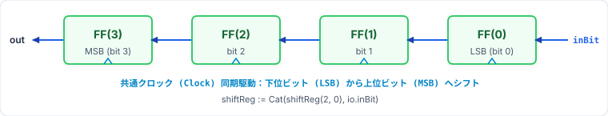
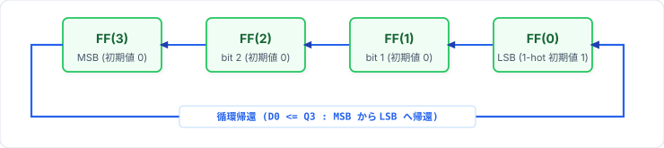
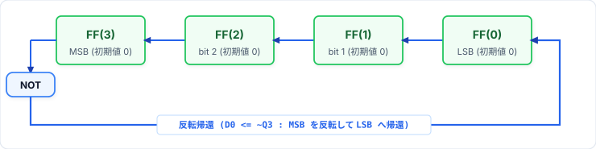

# 第4回: RingカウンタとJohnsonカウンタ
### 〜シフトレジスタの循環構造・1秒イネーブル連携と実機LED駆動〜

<br>

- **資料作成者**: Hideaki YANAGISAWA
- **講義時間**: 60分
- **対象**: デジタル論理回路基礎習得者
- **本日のアジェンダ**:
  1. 前回の復習（バイナリカウンタの課題と1秒ストローブ生成）
  2. シフトレジスタの基本構造とChiselでの配線 (`Cat`, ビットスライス)
  3. Ringカウンタのアーキテクチャと1-hot（ワンホット）状態遷移
  4. Johnsonカウンタ（モビウス・カウンタ）の $2N$ 状態巡回
  5. 1秒ストローブ (`enRingCounter` / `enJohnsonCounter`) を用いた実機対応Chisel実装
  6. 発展トピック: グレイコード・カウンタ（ハミング距離1遷移）とChisel実装
  7. 実機FPGA（TeCボード）配線仕様と本日の演習課題

<!-- Note:
第4回講義へようこそ。
前回は9MHzクロックから1秒パルスを生成し、二進数を数え上げるバイナリカウンタを学びました。
今回は、同じ1秒イネーブルパルスを使って駆動しながらも、全く異なるアプローチを取る「シフトレジスタ応用カウンタ（Ringカウンタ・Johnsonカウンタ）」と「グレイコードカウンタ」を扱います。
加算器を使わずにシフトと帰還だけで状態を巡回させる回路原理と、TeCボード実機で1秒ごとにLEDが移動・点灯する実装方法を学びます。
-->

---

## 1. バイナリカウンタの課題と特殊カウンタの意義

### バイナリカウンタ（前回復習）の特性
- $N$ 個のフリップフロップで $2^N$ 個の状態を表現（回路密度の最大化）。
- **デメリット**:
  1. 状態判定に**多入力デコーダ（ANDゲート網）**が必要 $\to$ 遅延と電力の増大。
  2. 複数ビットが同時に反転する（例: $0111 \to 1000$ では4ビット全反転）ため、**電源ノイズ（同時スイッチングノイズ: SSN）**と**出力グリッチ**が発生しやすい。

### シフトレジスタ応用カウンタの登場
加算器とデコーダを排除し、**「レジスタのシフト動作」と「出力の帰還」のみ**でシーケンスを生成する。

<!-- Note:
バイナリカウンタの弱点についての工学的解説です。
バイナリカウンタはFFの数を最小化できますが、0111から1000に変わるときのように、全ビットが一斉に反転する瞬間があります。
このとき急激な貫通電流が流れて電源電圧が揺れ、また各ビットの反転タイミングの微妙なズレが原因でデコード出力に激しいヒゲ（グリッチ）が出ます。
高速通信やタイミング制御では、ビット反転数が少なくデコーダが不要な特殊カウンタが求められます。
-->

---

## 2. シフトレジスタ (Shift Register) の基礎

フリップフロップを直列に接続し、クロック毎にデータを**下位ビット（右側: LSB）から上位ビット（左側: MSB）**へ転送する回路。

<p align="center">
  
</p>

### Chiselにおけるシフト動作の記述
ビットスライスと `Cat` を用いて、下位ビットから上位ビットへの移動（左シフト）と逆方向の移動（右シフト）を表現します。

```scala
val shiftReg = RegInit(0.U(4.W))

// 下位ビットから上位ビットへの左シフト (FF(0)->FF(1)->FF(2)->FF(3), LSBに inBit を挿入)
shiftReg := Cat(shiftReg(2, 0), io.inBit)

// 上位ビットから下位ビットへの右シフト (LSBを捨て、MSBに inBit を挿入)
shiftReg := Cat(io.inBit, shiftReg(3, 1))
```

<!-- Note:
シフトレジスタの基本構造です。
2進数の表記に合わせて、図の左側を最上位ビット（MSB: FF(3)）、右側を最下位ビット（LSB: FF(0)）として配置しています。
Chiselでは、Cat(shiftReg(2, 0), io.inBit) と書くだけで、下位3ビット（bit 2〜0）を1ビット上位（bit 3〜1）へ移動させ、空いた最下位ビット（bit 0）に inBit を入れる配線が1行で書けます。
加算器などの演算器を一切消費しない、純粋な配線とレジスタだけの低遅延回路です。
-->

---

## 3. Ringカウンタ (Ring Counter)

ビットを下位（LSB: `FF(0)`）から上位（MSB: `FF(3)`）へ移動させ、最上位ビット出力（MSB）を最下位ビット入力（LSB）にそのまま循環接続した回路。

<p align="center">
  
</p>

### 1-hot（ワンホット）符号状態遷移と実装例
$N$ 個のFFのうち、**常に1つのビットだけが `1` (High) で、他はすべて `0`**。下位ビットから上位ビットへ `1` が移動します。

$$0001_2 \longrightarrow 0010_2 \longrightarrow 0100_2 \longrightarrow 1000_2 \longrightarrow 0001_2 \cdots$$

```scala
val state = RegInit(1.U(width.W)) // 初期値 0001_2 (LSBのみ1)
state := Cat(state(width - 2, 0), state(width - 1)) // 下位ビットを上位へ、MSBをLSBへ帰還
```

<!-- Note:
Ringカウンタの動作です。
左側から3、2、1、0ビット（右側がLSB）として配置しています。
初期値として 0001（FF(0)=1）を入れておくと、イネーブルパルスが来るたびに 1 が下位ビット（右側）から上位ビット（左側）へと移動し、最上位のFF(3)から最下位のFF(0)へ循環帰還します。
実装コードの Cat(state(width - 2, 0), state(width - 1)) と図の配線が1対1で対応しています。
-->

---

## 4. Ringカウンタの工学的利点

### 1. 完全デコーダフリー (No Decoding Logic)
現在の状態を知るためにANDゲート等のデコーダ回路が一切不要。
- レジスタ出力ピン `out(0)` がそのまま「フェーズ0フラグ」になる。
- ゲート遅延ゼロで各ステージのイネーブル信号を取り出せる。

### 2. 超低消費電力 & 超高速クロック動作
- 帰還経路に組合せ論理ゲートが一切挟まらないため、クリティカルパス遅延は FFの $t_{co}$ (Clock-to-Output) + セットアップ時間 $t_{su}$ のみ。
- プロセッサのCPU命令実行フェーズ（Fetch $\to$ Decode $\to$ Execute $\to$ Writeback）のタイミングジェネレータに最適。

<!-- Note:
Ringカウンタの絶大なメリットです。
バイナリカウンタで「今フェーズ3か？」を判定するには、bit0とbit1のANDゲートを通す必要がありますが、Ringカウンタならout(3)のピンから直接信号を取るだけで済みます。
遅延はゼロ、ゲートによる電力消費もゼロです。CPUのマイクロシーケンサなどで極めて多用されます。
-->

---

## 5. Johnsonカウンタ（モビウス・カウンタ）

ビットを下位（LSB: `FF(0)`）から上位（MSB: `FF(3)`）へ移動させ、最上位ビット出力（MSB）を**「反転 (NOT)」**して最下位ビット入力（LSB）へ帰還させた回路。

<p align="center">
  
</p>

### 状態遷移シーケンス (4ビット: 8状態) と実装例
$$0000 \to 0001 \to 0011 \to 0111 \to 1111 \to 1110 \to 1100 \to 1000 \to 0000$$

```scala
val state = RegInit(0.U(width.W)) // 初期値 0000_2
state := Cat(state(width - 2, 0), ~state(width - 1)) // 下位ビットを上位へ、MSBの反転をLSBへ帰還
```

- 状態数: **$2 \times N$ 個**（4ビットで 8状態、Ringカウンタの2倍！）。

<!-- Note:
Johnsonカウンタ（別名モビウス・カウンタ）です。
左側の最上位ビット FF(3) の出力をNOTゲートで反転させて、右側の最下位ビット FF(0) に戻します。
すると、まず下位ビット（右側）から上位ビット（左側）へ向かって1が順番に充填されていき、全ビットが1（1111）になったら今度は下位ビットから上位ビットへ向かって0が順番に充填されていくという、2N個の状態を巡回します。
実装コードの Cat(state(width - 2, 0), ~state(width - 1)) と図の構造が完全に対応しています。
-->

---

## 6. Johnsonカウンタのデコード特性

### 2入力ANDゲートだけで全状態を完全デコード可能
Johnsonカウンタの任意の状態は、たった「2つのビットの論理積」だけで一意にデコードできます。

| 状態番号 | 4ビットパターン | デコード論理式 |
| :---: | :---: | :--- |
| **S0** | `0000` | $\overline{Q_3} \cdot \overline{Q_0}$ |
| **S1** | `0001` | $\overline{Q_1} \cdot Q_0$ |
| **S2** | `0011` | $\overline{Q_2} \cdot Q_1$ |
| **S3** | `0111` | $\overline{Q_3} \cdot Q_2$ |
| **S4** | `1111` | $Q_3 \cdot Q_0$ |
| **S5** | `1110` | $Q_1 \cdot \overline{Q_0}$ |
| **S6** | `1100` | $Q_2 \cdot \overline{Q_1}$ |
| **S7** | `1000` | $Q_3 \cdot \overline{Q_2}$ |

- バイナリカウンタ（4入力ANDゲートが必要）に比べ、デコード遅延が極小。
- 隣接状態間で**反転するビットは常に1ビットのみ** $\implies$ グリッチフリー！

<!-- Note:
Johnsonカウンタの素晴らしい特性です。
8つの状態のデコードが、すべて「2入力AND」で済みます。
しかも、状態が遷移するときに変化するビットは常に1ビットだけです。
同時に2つ以上のビットが変わらないため、デコード出力にスパイク状のグリッチが原理的に発生しません。
-->

---

## 7. RingカウンタのChisel実装 (`RingCounter.scala`)

第3回と同様、9MHzクロックから1秒パルス `enRingCounter` を生成し、1秒ごとに1-hot状態をシフトします。

```scala
class RingCounter(val width: Int = 4, val clkFreq: Int = 9000000) extends Module {
  val io = IO(new Bundle {
    val en     = Input(Bool())
    val clear  = Input(Bool())
    val runLED = Output(Bool())
    val out    = Output(UInt(width.W))
  })
  val halfPeriod = clkFreq / 2; val fullPeriod = clkFreq
  val cntReg = RegInit(0.U(log2Ceil(clkFreq).W))
  val state  = RegInit(1.U(width.W)) // 初期値 0001_2 (1-hot)
  val ledReg = RegInit(false.B)
  val enRingCounter = WireDefault(false.B)

  // 1. 9MHz分周カウンタ更新論理 & 1秒ストローブ生成
  when(io.clear) { cntReg := 0.U }.elsewhen(io.en) {
    when(cntReg === (clkFreq - 1).U) { cntReg := 0.U }.otherwise { cntReg := cntReg + 1.U }
  }
  enRingCounter := io.en && (cntReg === (fullPeriod - 1).U)

  // 2. Ringカウンタ状態更新論理 (clear時は 1.U、1秒毎に下位から上位へ循環シフト)
  when(io.clear) { state := 1.U }.elsewhen(enRingCounter) {
    state := Cat(state(width - 2, 0), state(width - 1))
  }

  // 3. LED点滅更新論理 & 4. 出力論理 (実機観測時は ~state に切替可能)
  when(io.clear) { ledReg := true.B }.elsewhen(io.en) {
    when(cntReg === (halfPeriod - 1).U || cntReg === (fullPeriod - 1).U) { ledReg := !ledReg }
  }
  io.out    := state   // 実機LED負論理点灯時は io.out := ~state
  io.runLED := ~ledReg
}
```

<!-- Note:
Implement/Lab04/assignment1/RingCounter.scala の完全実装です。
第3回の ModuloNCounter と全く同じ構造で、まず cntReg で9MHzを数えて1秒に1クロックだけ High になる enRingCounter を作ります。
そして state レジスタは、clear が押されたら初期値 1.U（0001_2）に戻り、enRingCounter が来た瞬間に Cat(state(width - 2, 0), state(width - 1)) で1ビット上位へ循環シフトします。
テストベンチ実行時は io.out := state で正論理検証し、TeCボード実機で「1のビットだけLEDを点灯」させたい場合はコメントアウトを切り替えて io.out := ~state とすることで負論理LEDに対応できます。
-->

---

## 8. JohnsonカウンタのChisel実装 (`JohnsonCounter.scala`)

`enJohnsonCounter` パルスごとに、最上位ビットの反転 `~state(width - 1)` を最下位ビットへ帰還します。

```scala
class JohnsonCounter(val width: Int = 4, val clkFreq: Int = 9000000) extends Module {
  val io = IO(new Bundle {
    val en     = Input(Bool())
    val clear  = Input(Bool())
    val runLED = Output(Bool())
    val out    = Output(UInt(width.W))
  })
  val halfPeriod = clkFreq / 2; val fullPeriod = clkFreq
  val cntReg = RegInit(0.U(log2Ceil(clkFreq).W))
  val state  = RegInit(0.U(width.W)) // 初期値 0000_2
  val ledReg = RegInit(false.B)
  val enJohnsonCounter = WireDefault(false.B)

  // 1. 9MHz分周カウンタ更新論理 & 1秒ストローブ生成
  when(io.clear) { cntReg := 0.U }.elsewhen(io.en) {
    when(cntReg === (clkFreq - 1).U) { cntReg := 0.U }.otherwise { cntReg := cntReg + 1.U }
  }
  enJohnsonCounter := io.en && (cntReg === (fullPeriod - 1).U)

  // 2. Johnsonカウンタ状態更新論理 (clear時は 0.U、1秒毎にMSBの反転をLSBへ帰還)
  when(io.clear) { state := 0.U }.elsewhen(enJohnsonCounter) {
    state := Cat(state(width - 2, 0), ~state(width - 1))
  }

  // 3. LED点滅更新論理 & 4. 出力論理
  when(io.clear) { ledReg := false.B }.elsewhen(io.en) {
    when(cntReg === (halfPeriod - 1).U || cntReg === (fullPeriod - 1).U) { ledReg := !ledReg }
  }
  io.out    := state   // 実機LED負論理点灯時は io.out := ~state
  io.runLED := ~ledReg
}
```

<!-- Note:
Implement/Lab04/assignment2/JohnsonCounter.scala の完全実装です。
Ringカウンタとの違いは2箇所だけです。
1つ目は state の初期値と clear 時の値が 0.U（0000_2）であること。
2つ目は Cat(state(width - 2, 0), ~state(width - 1)) と、最上位ビットを ~ で反転して最下位ビットへ入れていることです。
また出力段では、テストベンチ検証時は io.out := state、TeCボード実機の負論理LEDで点灯確認する際は io.out := ~state を使います。
-->

---

## 9. 初期値設計と未使用状態（Unused States）の注意点

### 初期値（`RegInit` および `io.clear`）の重要性
- **Ringカウンタ**:
  - 初期値を誤って `0.U` (`0000_2`) にすると、いくらシフトしても永久に `0000_2` のまま変化しない。
  - 必ず **`RegInit(1.U(width.W))`** および `when(io.clear) { state := 1.U }` で1-hot初期状態を与える。
- **Johnsonカウンタ**:
  - 初期値 **`RegInit(0.U(width.W))`** および `when(io.clear) { state := 0.U }` から開始することで、正規の8状態ループ（`0000` $\sim$ `1000`）を巡回する。

<div class="box">
<b>未使用状態 (Unused States) の存在</b><br>
4ビットレジスタの全 $2^4 = 16$ 状態のうち、Ringカウンタは4状態（残り12状態は未使用）、Johnsonカウンタは8状態（残り8状態は未使用）のみを使用する。そのため、リセットおよび <code>clear</code> による確実な初期値設定が不可欠である。
</div>

<!-- Note:
初期値設計と未使用状態に関する注意点です。
Ringカウンタは自分自身のビットをそのまま循環させるため、もしリセット時や clear 時に 0000 にしてしまうと、永久に0のまま動きません。必ず 1.U に初期化します。
-->

---

## 10. 発展課題: グレイコード・カウンタ (Gray Code Counter)

### グレイコード（交番2進符号）とは
隣接するどの2つの数値の間でも、**変化するビットが常に「厳密に1ビットだけ」**である特殊な2進数コード。

<div style="display: flex; justify-content: space-between;">
<div style="width: 48%;">

### 通常の2進数 (`bin`: 4bit)
- $0000 \to 0001$ (1bit変化)
- $0001 \to 0010$ (2bit変化)
- $0011 \to 0100$ (3bit変化)
- $0111 \to 1000$ (**4bit全変化**)

</div>
<div style="width: 48%;">

### グレイコード (`gray`: 4bit)
- $0000 \to 0001$ (1bit変化)
- $0001 \to 0011$ (1bit変化)
- $0011 \to 0010$ (1bit変化)
- $0010 \to 0110$ (1bit変化)
- 常に**ハミング距離 $= 1$**

</div>
</div>

- **用途**: ロータリーエンコーダ（角度センサ）、非同期FIFOのポインタ受け渡し。

<!-- Note:
発展課題で取り組むグレイコード・カウンタです。
通常のバイナリでは、0111から1000に変わる際、4つのビットが完全に同時に反転することは物理的にあり得ず、過渡的に 0110 や 1111 などの偽のコードが一瞬出力されてしまいます。
グレイコードなら常に1ビットしか動かないため、非同期回路境界をまたぐ通信で読み取りミスが絶対に起きません。
-->

---

## 11. バイナリ $\to$ グレイコード変換と回路構成

### 変換論理式
第 $i$ ビットのグレイコード $G_i$ は、バイナリの自身 $B_i$ と1つ上位ビット $B_{i+1}$ の排他的論理和（XOR）。

$$G_i = B_i \oplus B_{i+1} \quad \Longleftrightarrow \quad \mathbf{G} = \mathbf{B} \oplus (\mathbf{B} \gg 1)$$

```scala
val gray = binReg ^ (binReg >> 1) // わずか1行で変換可能！
```

<p align="center">
  
</p>

<!-- Note:
バイナリからグレイコードへの変換アルゴリズムと全体構成です。
内部レジスタ binReg を標準バイナリカウンタとして1秒ごとに +1 進め、その出力を `binReg ^ (binReg >> 1)` のXORゲートアレイに通すことで、グレイコード `gray` を生成します。
-->

---

## 12. グレイコード・カウンタのChisel実装 (`GrayCodeCounter.scala`)

```scala
class GrayCodeCounter(val width: Int = 4, val clkFreq: Int = 9000000) extends Module {
  val io = IO(new Bundle {
    val en     = Input(Bool())
    val clear  = Input(Bool())
    val runLED = Output(Bool())
    val gray   = Output(UInt(4.W))
    val bin    = Output(UInt(4.W))
  })
  val halfPeriod = clkFreq / 2; val fullPeriod = clkFreq
  val cntReg = RegInit(0.U(log2Ceil(clkFreq).W))
  val binReg = RegInit(0.U(width.W))
  val ledReg = RegInit(false.B)
  val enGrayCodeCounter = WireDefault(false.B)

  // 1. 9MHz分周カウンタ更新論理 & 1秒ストローブ生成
  when(io.clear) { cntReg := 0.U }.elsewhen(io.en) {
    when(cntReg === (clkFreq - 1).U) { cntReg := 0.U }.otherwise { cntReg := cntReg + 1.U }
  }
  enGrayCodeCounter := io.en && (cntReg === (fullPeriod - 1).U)

  // 2. バイナリカウンタ更新論理 (1秒毎に +1)
  when(io.clear) { binReg := 0.U }.elsewhen(enGrayCodeCounter) { binReg := binReg + 1.U }

  // 3. LED点滅更新論理 & 4. グレイコード変換・負論理出力
  when(io.clear) { ledReg := false.B }.elsewhen(io.en) {
    when(cntReg === (halfPeriod - 1).U || cntReg === (fullPeriod - 1).U) { ledReg := !ledReg }
  }
  val gray = binReg ^ (binReg >> 1)
  io.gray   := ~gray
  io.bin    := ~binReg
  io.runLED := ~ledReg
}
```

<!-- Note:
Implement/Lab04/assignment3/GrayCodeCounter.scala の完全実装です。
1秒パルス enGrayCodeCounter によって内部バイナリレジスタ binReg を +1.U ずつカウントアップします。
そして val gray = binReg ^ (binReg >> 1) でグレイコードに変換し、TeCボードのLED（DATA_LEDおよびADDR_LED等）に合わせて負論理（~gray, ~binReg, ~ledReg）で出力します。
なお、ビットごとの反転（~）を行っても、隣接状態間で変化するビット数（ハミング距離＝1）は全く変わらず保たれます。
-->

---

## 13. カウンタ回路方式の比較と選定ガイドライン

| 特性 | バイナリカウンタ | Ringカウンタ | Johnsonカウンタ | グレイコード |
| :--- | :---: | :---: | :---: | :---: |
| **FF数 ($N$状態)** | $\lceil \log_2 N \rceil$ | $N$ | $N / 2$ | $\lceil \log_2 N \rceil$ |
| **デコーダ回路** | $N$入力AND | **不要 (0ゲート)** | 2入力AND | 複雑 |
| **反転ビット数** | 最大 $N$ ビット | 2ビット | **1ビット** | **1ビット** |
| **最大動作周波数** | 中 (加算器律速) | **極高 (配線のみ)** | **極高** | 高 |
| **初期値 (`RegInit`)** | `0.U` | **`1.U` (1-hot必須)** | `0.U` | `0.U` |

<!-- Note:
4種類のカウンタの比較表です。
ビット数を節約したいならバイナリ、とにかく最高クロック周波数でデコーダなしに動かしたいならRing、その半分のFF数でグリッチフリーにしたいならJohnson、全2^N状態をハミング距離1で巡回したいならグレイコード、というように適材適所で使い分けます。
-->

---

## 14. 実機FPGA (TeCボード) 配線仕様（UCF対応表）

各課題の `.ucf` ファイルに基づき、TeCボードのスイッチ・LEDへ接続して1秒ごとの状態遷移を確認します。

| 信号名 | 課題1 (`Ring`) | 課題2 (`Johnson`) | 課題3 (`GrayCode`) | TeCボード端子・ピン番号 |
| :--- | :---: | :---: | :---: | :--- |
| `clock` | ○ | ○ | ○ | `CLK_IN` (`P55`: 9MHz) |
| `io_en` | ○ | ○ | ○ | `RUN_SW` (`P16` \| PULLUP) |
| `io_clear` | ○ | ○ | ○ | `RESET_SW` (`P120` \| PULLUP) |
| `io_runLED` | ○ | ○ | ○ | `RUN_LED` (`P43`: 0.5秒反転) |
| `io_out[3:0]` / `io_gray[3:0]` | `io_out[3:0]` | `io_out[3:0]` | `io_gray[3:0]` | `DATA_LED[3:0]` (`P62, P61, P59, P58`) |
| `io_bin[3:0]` | — | — | `io_bin[3:0]` | 拡張LED端子 (`P87, P85, P84, P83`) |

- **負論理LED表示のポイント**: TeCボードのLEDは `0` で点灯するため、実機書き込み時は `~state` / `~gray` / `~binReg` と反転出力することで、ビット `1` の位置が点灯します。

<!-- Note:
Implement/Lab04 配下の各 .ucf ファイルに対応したTeCボードのピン配置表です。
3つの課題すべてで、clockはP55、io_enはP16（RUN_SW）、io_clearはP120（RESET_SW）、io_runLEDはP43（RUN_LED）に共通接続します。
そしてRingとJohnsonの io_out[3:0]、およびGrayCodeの io_gray[3:0] は DATA_LED（P62, P61, P59, P58）に接続し、GrayCodeのバイナリ比較出力 io_bin[3:0] は P87, P85, P84, P83 に接続します。
-->

---

## 15. 本日の演習課題 (90分)

演習は**基本問題（2問）**と**発展問題（1問）**の構成です（テスト時は `clkFreq = 4` で高速検証）。

### 基本問題（必須 / 目安45〜50分）
1. **課題1: `RingCounter(width = 4, clkFreq = 9000000)`**:
   - 9MHz分周による1秒パルス `enRingCounter` の生成と、`clear` 時の `1.U` 初期化
   - 下位ビットから上位ビットへのシフトとMSB帰還 (`Cat(state(width - 2, 0), state(width - 1))`)
2. **課題2: `JohnsonCounter(width = 4, clkFreq = 9000000)`**:
   - 1秒パルス `enJohnsonCounter` の生成と、`clear` 時の `0.U` 初期化
   - 最上位ビットの反転帰還 (`Cat(state(width - 2, 0), ~state(width - 1))`) による8状態巡回

### 発展問題（推奨 / 目安30〜35分）
3. **課題3: `GrayCodeCounter(width = 4, clkFreq = 9000000)`**:
   - 1秒パルス `enGrayCodeCounter` によるバイナリカウントと `binReg ^ (binReg >> 1)` 変換

<!-- Note:
演習の案内です。
テストベンチ（RingCountertb, JohnsonCountertb, GrayCodeCountertb）では clkFreq = 4 を渡して4クロック＝1秒として高速にシミュレーション検証を行います。
テストに通ったら VerilogGenerator で SystemVerilog を生成し、実機での動作も確認してください。
-->

---

## 16. 第4回 まとめ & 次回予告

### 本日の重要ポイント
1. シフトレジスタは `Cat` とビットスライスで加算器なしに高速に構成できる。
2. Ringカウンタは下位から上位へのシフトとMSB帰還による1-hot遷移で、**デコーダ不要・最高速動作**を実現する。
3. JohnsonカウンタはMSBの反転帰還により $2N$ 状態を巡回し、2入力ANDでグリッチフリーにデコード可能。
4. グレイコード・カウンタは `binReg ^ (binReg >> 1)` により全遷移で**ハミング距離1**を保証する。
5. 実機動作では9MHz分周の1秒ストローブパルス（`enRingCounter` 等）を同期イネーブルとして用い、1秒ごとの状態遷移を駆動する。

### 次回予告: 第5回「60進カウンタの構造化設計」
- モジュール階層化設計の基礎とインスタンス化 (`Module(new ...)`)
- 非同期リップルクロックの厳禁と、`OneHzGenerator` + 10進 + 6進による60進カウンタ設計

<!-- Note:
第4回の講義は以上となります。
それでは演習に移ります。Lab04の課題を開いて作業を開始してください。
-->
