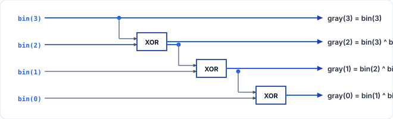

# 第4回: RingカウンタとJohnsonカウンタ
### 〜シフトレジスタの循環構造と1-hot / 2N状態巡回カウンタ〜

<br>

- **資料作成者**: Hideaki YANAGISAWA
- **講義時間**: 60分
- **対象**: デジタル論理回路基礎習得者
- **本日のアジェンダ**:
  1. 前回の復習（バイナリカウンタの限界とデコード遅延）
  2. シフトレジスタの基本構造とChiselでの配線 (`Cat`, ビットスライス)
  3. Ringカウンタのアーキテクチャと1-hot（ワンホット）状態
  4. Johnsonカウンタ（モビウス・カウンタ）の $2N$ 状態巡回
  5. Ringカウンタ・JohnsonカウンタのChisel実装
  6. 発展トピック: グレイコード・カウンタ（ハミング距離1遷移）
  7. 本日の演習課題（基本: Ring & Johnson / 発展: グレイコード）

<!-- Note:
第4回講義へようこそ。
前回は二進数を数え上げるバイナリカウンタを学びました。
今回は、同じカウンタでも全く異なるアプローチを取る「シフトレジスタ応用カウンタ」を扱います。
RingカウンタやJohnsonカウンタは、加算器を使わずにシフトと帰還だけで状態を巡回させるため、超高速動作や低消費電力、グリッチフリーなタイミング信号生成に広く使われています。
-->

---

## 1. バイナリカウンタの課題と特殊カウンタの意義

### バイナリカウンタ（前回復習）の特性
- $N$ 個のフリップフロップで $2^N$ 個の状態を表現（回路密度の最大化）。
- **デメリット**:
  1. 状態判定に**多入力デコーダ（ANDゲート網）**が必要 $\to$ 遅延と電力の増大。
  2. 複数ビットが同時に反転する（例: $0111 \to 1000$ では4ビット全反転）ため、**電源ノイズ（同時スイッチングノイズ: SSN）**と**出力グリッチ**が発生しやすい。

### シフトレジスタ応用カウンタの登場
加算器とデコーダを排除し、**「レジスタのシフト動作」と「出力の帰還」のみ**でシーケンスを生成する。

<!-- Note:
バイナリカウンタの弱点についての工学的解説です。
バイナリカウンタはFFの数を最小化できますが、0111から1000に変わるときのように、全ビットが一斉に反転する瞬間があります。
このとき急激な貫通電流が流れて電源電圧が揺れ、また各ビットの反転タイミングの微妙なズレが原因でデコード出力に激しいヒゲ（グリッチ）が出ます。
高速通信やタイミング制御では、ビット反転数が少なくデコーダが不要な特殊カウンタが求められます。
-->

---

## 2. シフトレジスタ (Shift Register) の基礎

フリップフロップを直列に接続し、クロック毎にデータを**下位ビット（右側: LSB）から上位ビット（左側: MSB）**へ転送する回路。

<p align="center">
  
</p>

### Chiselにおけるシフト動作の記述
ビットスライスと `Cat` を用いて、下位ビットから上位ビットへの移動（左シフト）と逆方向の移動（右シフト）を表現します。

```scala
val shiftReg = RegInit(0.U(4.W))

// 下位ビットから上位ビットへの左シフト (FF(0)->FF(1)->FF(2)->FF(3), LSBに inBit を挿入)
shiftReg := Cat(shiftReg(2, 0), io.inBit)

// 上位ビットから下位ビットへの右シフト (LSBを捨て、MSBに inBit を挿入)
shiftReg := Cat(io.inBit, shiftReg(3, 1))
```

<!-- Note:
シフトレジスタの基本構造です。
2進数の表記に合わせて、図の左側を最上位ビット（MSB: FF(3)）、右側を最下位ビット（LSB: FF(0)）として配置しています。
Chiselでは、Cat(shiftReg(2, 0), io.inBit) と書くだけで、下位3ビット（bit 2〜0）を1ビット上位（bit 3〜1）へ移動させ、空いた最下位ビット（bit 0）に inBit を入れる配線が1行で書けます。
加算器などの演算器を一切消費しない、純粋な配線とレジスタだけの低遅延回路です。
-->

---

## 3. Ringカウンタ (Ring Counter)

ビットを下位（LSB: `FF(0)`）から上位（MSB: `FF(3)`）へ移動させ、最上位ビット出力（MSB）を最下位ビット入力（LSB）にそのまま循環接続した回路。

<p align="center">
  
</p>

### 1-hot（ワンホット）符号状態遷移と実装例
$N$ 個のFFのうち、**常に1つのビットだけが `1` (High) で、他はすべて `0`**。下位ビットから上位ビットへ `1` が移動します。

$$0001_2 \longrightarrow 0010_2 \longrightarrow 0100_2 \longrightarrow 1000_2 \longrightarrow 0001_2 \cdots$$

```scala
val state = RegInit(1.U(4.W)) // 初期値 0001_2 (LSBのみ1)
state := Cat(state(2, 0), state(3)) // 下位3bitを上位へシフトし、MSB(bit 3)をLSB(bit 0)へ帰還
```

<!-- Note:
Ringカウンタの動作です。
左側から3、2、1、0ビット（右側がLSB）として配置しています。
初期値として 0001（FF(0)=1）を入れておくと、クロックが来るたびに 1 が下位ビット（右側）から上位ビット（左側）へと移動し、最上位のFF(3)から最下位のFF(0)へ循環帰還します。
実装コードの Cat(state(2, 0), state(3)) と図の配線が1対1で対応しています。
-->

---

## 4. Ringカウンタの工学的利点

### 1. 完全デコーダフリー (No Decoding Logic)
現在の状態を知るためにANDゲート等のデコーダ回路が一切不要。
- レジスタ出力ピン `out(0)` がそのまま「フェーズ0フラグ」になる。
- ゲート遅延ゼロで各ステージのイネーブル信号を取り出せる。

### 2. 超低消費電力 & 超高速クロック動作
- 帰還経路に組合せ論理ゲートが一切挟まらないため、クリティカルパス遅延は FFの $t_{co}$ (Clock-to-Output) + セットアップ時間 $t_{su}$ のみ。
- プロセッサのCPU命令実行フェーズ（Fetch $\to$ Decode $\to$ Execute $\to$ Writeback）のタイミングジェネレータに最適。

<!-- Note:
Ringカウンタの絶大なメリットです。
バイナリカウンタで「今フェーズ3か？」を判定するには、bit0とbit1のANDゲートを通す必要がありますが、Ringカウンタならout(3)のピンから直接信号を取るだけで済みます。
遅延はゼロ、ゲートによる電力消費もゼロです。CPUのマイクロシーケンサなどで極めて多用されます。
-->

---

## 5. Johnsonカウンタ（モビウス・カウンタ）

ビットを下位（LSB: `FF(0)`）から上位（MSB: `FF(3)`）へ移動させ、最上位ビット出力（MSB）を**「反転 (NOT)」**して最下位ビット入力（LSB）へ帰還させた回路。

<p align="center">
  
</p>

### 状態遷移シーケンス (4ビット: 8状態) と実装例
$$0000 \to 0001 \to 0011 \to 0111 \to 1111 \to 1110 \to 1100 \to 1000 \to 0000$$

```scala
val state = RegInit(0.U(4.W)) // 初期値 0000_2
state := Cat(state(2, 0), ~state(3)) // 下位3bitを上位へシフトし、MSBの反転(~bit 3)をLSBへ帰還
```

- 状態数: **$2 \times N$ 個**（4ビットで 8状態、Ringカウンタの2倍！）。

<!-- Note:
Johnsonカウンタ（別名モビウス・カウンタ）です。
左側の最上位ビット FF(3) の出力をNOTゲートで反転させて、右側の最下位ビット FF(0) に戻します。
すると、まず下位ビット（右側）から上位ビット（左側）へ向かって1が順番に充填されていき、全ビットが1（1111）になったら今度は下位ビットから上位ビットへ向かって0が順番に充填されていくという、2N個の状態を巡回します。
実装コードの Cat(state(2, 0), ~state(3)) と図の構造が完全に対応しています。
-->

---

## 6. Johnsonカウンタのデコード特性

### 2入力ANDゲートだけで全状態を完全デコード可能
Johnsonカウンタの任意の状態は、たった「2つのビットの論理積」だけで一意にデコードできます。

| 状態番号 | 4ビットパターン | デコード論理式 |
| :---: | :---: | :--- |
| **S0** | `0000` | $\overline{Q_3} \cdot \overline{Q_0}$ |
| **S1** | `0001` | $\overline{Q_1} \cdot Q_0$ |
| **S2** | `0011` | $\overline{Q_2} \cdot Q_1$ |
| **S3** | `0111` | $\overline{Q_3} \cdot Q_2$ |
| **S4** | `1111` | $Q_3 \cdot Q_0$ |
| **S5** | `1110` | $Q_1 \cdot \overline{Q_0}$ |
| **S6** | `1100` | $Q_2 \cdot \overline{Q_1}$ |
| **S7** | `1000` | $Q_3 \cdot \overline{Q_2}$ |

- バイナリカウンタ（4入力ANDゲートが必要）に比べ、デコード遅延が極小。
- 隣接状態間で**反転するビットは常に1ビットのみ** $\implies$ グリッチフリー！

<!-- Note:
Johnsonカウンタの素晴らしい特性です。
8つの状態のデコードが、すべて「2入力AND」で済みます。
しかも、状態が遷移するときに変化するビットは常に1ビットだけです。
同時に2つ以上のビットが変わらないため、デコード出力にスパイク状のグリッチが原理的に発生しません。
-->

---

## 7. RingカウンタのChisel実装

下位ビット（`state(width - 2, 0)`）を上位ビット側へシフトし、最上位ビット（`state(width - 1)`）を最下位ビットへ循環接続します。

```scala
class RingCounter(val width: Int = 4) extends Module {
  val io = IO(new Bundle {
    val en  = Input(Bool())
    val out = Output(UInt(width.W))
  })

  // リセット時は 1-hot 初期値 0001_2 (1.U) に設定
  val state = RegInit(1.U(width.W))

  when(io.en) {
    // 下位ビットから上位ビットへ移動し、MSBをLSBへ循環帰還
    state := Cat(state(width - 2, 0), state(width - 1))
  }

  io.out := state
}
```

- 初期値を `1.U(width.W)`（`0001_2`）とすることで、クロック毎に `0001` $\to$ `0010` $\to$ `0100` $\to$ `1000` $\to$ `0001` と巡回する。

<!-- Note:
RingカウンタのChisel実装です。
初期値は必ず1ビットだけが1である 1.U（4ビットなら0001）で初期化します。
enがHighのとき、Cat(state(width - 2, 0), state(width - 1)) によって、下位ビットが1つ上位へ移動し、最上位ビットが最下位ビットへと帰還します。
-->

---

## 8. JohnsonカウンタのChisel実装

下位ビット（`state(width - 2, 0)`）を上位ビット側へシフトし、最上位ビットの反転（`~state(width - 1)`）を最下位ビットへ帰還接続します。

```scala
class JohnsonCounter(val width: Int = 4) extends Module {
  val io = IO(new Bundle {
    val en  = Input(Bool())
    val out = Output(UInt(width.W))
  })

  // リセット時は全ビット 0 (0000_2) に設定
  val state = RegInit(0.U(width.W))

  when(io.en) {
    // 下位ビットから上位ビットへ移動し、MSBの反転をLSBへ帰還
    state := Cat(state(width - 2, 0), ~state(width - 1))
  }

  io.out := state
}
```

- わずか1箇所（`~state(width - 1)` のビット反転）の違いで、状態数が $N$ 個から $2N$ 個（8状態）へ倍増する。

<!-- Note:
JohnsonカウンタのChisel実装です。
Ringカウンタとのコード上の違いは、初期値が 0.U であることと、Catの第2引数が ~state(width - 1) と反転している点だけです。
これだけで、0000から始まって1が下位から上位へ満たされ、1111に達した後は0が下位から上位へ満たされる8状態巡回カウンタになります。
-->

---

## 9. 初期値設計と未使用状態（Unused States）の注意点

### 初期値（`RegInit`）の重要性
- **Ringカウンタ**:
  - 初期値を誤って `0.U` (`0000_2`) にすると、いくらシフトしても永久に `0000_2` のまま変化しない。
  - 必ず **`RegInit(1.U(width.W))`** で1-hot初期状態を与える。
- **Johnsonカウンタ**:
  - 初期値 **`RegInit(0.U(width.W))`** から開始することで、正規の8状態ループ（`0000` $\sim$ `1000`）を巡回する。

<div class="box">
<b>未使用状態 (Unused States) の存在</b><br>
4ビットレジスタの全 $2^4 = 16$ 状態のうち、Ringカウンタは4状態（残り12状態は未使用）、Johnsonカウンタは8状態（残り8状態は未使用）のみを使用する。そのため、リセットによる確実な初期値設定が不可欠である。
</div>

<!-- Note:
初期値設計と未使用状態に関する注意点です。
Ringカウンタは自分自身のビットをそのまま循環させるため、もしリセット時に 0000 になっていると、永久に0のまま動きません。
また、4ビット16通りのうち、Ringカウンタは4通り、Johnsonカウンタは8通りしか使いません。したがって、RegInit によって確実な初期状態からスタートさせることが順序回路設計の基本となります。
-->

---

## 10. 発展課題: グレイコード・カウンタ (Gray Code Counter)

### グレイコード（交番2進符号）とは
隣接するどの2つの数値の間でも、**変化するビットが常に「厳密に1ビットだけ」**である特殊な2進数コード。

<div style="display: flex; justify-content: space-between;">
<div style="width: 48%;">

### 通常の2進数 (4bit)
- $0000 \to 0001$ (1bit変化)
- $0001 \to 0010$ (2bit変化)
- $0011 \to 0100$ (3bit変化)
- $0111 \to 1000$ (**4bit全変化**)

</div>
<div style="width: 48%;">

### グレイコード (4bit)
- $0000 \to 0001$ (1bit)
- $0001 \to 0011$ (1bit)
- $0011 \to 0010$ (1bit)
- $0010 \to 0110$ (1bit)
- 常にハミング距離 $= 1$

</div>
</div>

- **用途**: ロータリーエンコーダ（角度センサ）、非同期FIFOのポインタ受け渡し。

<!-- Note:
発展課題で取り組むグレイコード・カウンタです。
通常のバイナリでは、0111から1000に変わる際、4つのビットが完全に同時に反転することは物理的にあり得ず、過渡的に 0110 や 1111 などの偽のコードが一瞬出力されてしまいます。
グレイコードなら常に1ビットしか動かないため、非同期回路境界をまたぐ通信で読み取りミスが絶対に起きません。
-->

---

## 11. バイナリ $\iff$ グレイコードの相互変換論理

### バイナリコード $B$ から グレイコード $G$ への変換
第 $i$ ビットのグレイコード $G_i$ は、バイナリの自身と1つ上位ビットの排他的論理和。

$$G_i = B_i \oplus B_{i+1}$$
$$\mathbf{G} = \mathbf{B} \oplus (\mathbf{B} \gg 1)$$

```scala
val gray = bin ^ (bin >> 1) // わずか1行で変換可能！
```

### ハードウェア構成
<p align="center">
  
</p>

<!-- Note:
バイナリからグレイコードへの変換アルゴリズムです。
数式で見ると難しそうに見えますが、ハードウェア的には「自分自身と、1ビット右シフトした値のXORを取る」だけです。
Chiselでは `bin ^ (bin >> 1)` と書くだけで、図のような並列XORゲートアレイが瞬時に合成されます。
-->

---

## 12. グレイコード・カウンタのアーキテクチャ

内部に通常のバイナリカウンタを保持し、出力段でグレイコードへ変換するのが最も面積効率と速度に優れます。

<p align="center">
  
</p>

- 内部レジスタはシンプルな `binReg + 1.U` でインクリメント。
- 出力段の1段のXORゲートアレイを経て、常にハミング距離1の `gray` を出力。

<!-- Note:
グレイコードカウンタの設計手法です。
グレイコードのまま次の値を計算する次状態論理を組むことも可能ですが、式が非常に複雑になります。
実務では、内部レジスタを標準バイナリカウンタとして進め、その出力を1段のXOR回路を通してグレイコードとして取り出す方式が最も標準的で信頼性が高くなります。
-->

---

## 13. カウンタ回路方式の比較と選定ガイドライン

| 特性 | バイナリカウンタ | Ringカウンタ | Johnsonカウンタ | グレイコード |
| :--- | :---: | :---: | :---: | :---: |
| **FF数 ($N$状態)** | $\lceil \log_2 N \rceil$ | $N$ | $N / 2$ | $\lceil \log_2 N \rceil$ |
| **デコーダ回路** | $N$入力AND | **不要 (0ゲート)** | 2入力AND | 複雑 |
| **反転ビット数** | 最大 $N$ ビット | 2ビット | **1ビット** | **1ビット** |
| **最大動作周波数** | 中 (加算器律速) | **極高 (配線のみ)** | **極高** | 高 |
| **初期値 (`RegInit`)** | `0.U` | **`1.U` (1-hot必須)** | `0.U` | `0.U` |

<!-- Note:
4種類のカウンタの比較表です。
受講者の皆さんが将来ハードウェアを設計する際、どのカウンタを採用すべきかの指針となります。
ビット数をケチりたいならバイナリ、とにかく最高クロック周波数で動かしたいならRing、グリッチを絶対に許容できないセンサ系やFIFOポインタならグレイコード、というように適材適所で使い分けます。
-->

---

## 14. 順序回路におけるグリッチのメカニズム

なぜ多ビット変化は危険なのか？

```
バイナリ遷移 (01 -> 10) の物理波形:
bit 0: ──‾‾‾‾‾‾‾‾\_______  (立ち下がりがわずかに遅れた場合)
bit 1: _________/‾‾‾‾‾‾‾‾  (立ち上がりが早い)
過渡状態:   [01]   [11]   [10]  <── 一瞬だけ "11" が出現！
```

- この一瞬の `11` が後段の組合せ回路を通ると、予期せぬ**グリッチパルス**となって誤動作を引き起こす。
- **1ビットのみ変化するカウンタ (Johnson / Gray)** はこの過渡状態が原理的に存在しない。

<!-- Note:
グリッチ発生のメカニズムです。
物理的な配線やトランジスタには必ず遅延のバラツキがあります。
01から10に切り替わるとき、bit1が立ち上がるタイミングとbit0が立ち下がるタイミングが1ピコ秒でもズレると、一瞬だけ「11」という偽の状態が現れます。
これが後段のクロックやリセットに繋がっていると、致命的な誤動作を引き起こします。
-->

---

## 15. 本日の演習課題 (90分)

演習は**基本問題**と**発展問題**の2段階構成です。

### 基本問題（必須 / 目安45〜50分）
1. **`RingCounter`**:
   - 下位ビットから上位ビットへのシフトと、最上位ビットを最下位ビットへ戻す1-hot循環シフトレジスタの実装
2. **`JohnsonCounter`**:
   - 最上位ビットの反転帰還による $2N$（8状態）巡回カウンタの実装

### 確認課題
- **`GrayCodeCounter`**:
  - 内部バイナリカウンタとグレイコード変換回路の統合
  - 全遷移におけるハミング距離1動作の確認

### バッファ (5〜10分)
- コード整形、テスト実行、質疑応答

<!-- Note:
演習の案内です。
基本問題では、4ビットのRingCounterおよびJohnsonCounterを実装し、それぞれの状態遷移（4状態巡回および8状態巡回）をシミュレーションで確認してください。
発展問題ではグレイコードカウンタに挑戦し、隣接コードが1ビットしか変わらないことを波形で確かめてください。
-->

---

## 16. 第4回 まとめ & 次回予告

### 本日の重要ポイント
1. シフトレジスタは `Cat` とビットスライスで加算器なしに高速に構成できる。
2. Ringカウンタは下位から上位へのシフトとMSB帰還による1-hot遷移で、**デコーダ不要・最高速動作**を実現する。
3. JohnsonカウンタはMSBの反転帰還により $2N$ 状態を巡回し、2入力ANDでグリッチフリーにデコード可能。
4. Ringカウンタは `1.U`、Johnsonカウンタは `0.U` の適切なリセット初期値 (`RegInit`) 設定が不可欠である。

### 次回予告: 第5回「60進カウンタの構造化設計」
- モジュール階層化の基礎とインスタンス化 (`Module(new ...)`)
- 非同期リップルクロックの厳禁と同期イネーブル桁上げ伝播
- 10進×6進カスケードによる60進カウンタおよび時計コアの設計

<!-- Note:
第4回の講義は以上となります。
特殊カウンタの持つ高速性と低ノイズ性、そして初期値設計の重要性を理解していただけたかと思います。
それでは演習に移ります。Lab04の課題を開いて作業を開始してください。
-->
