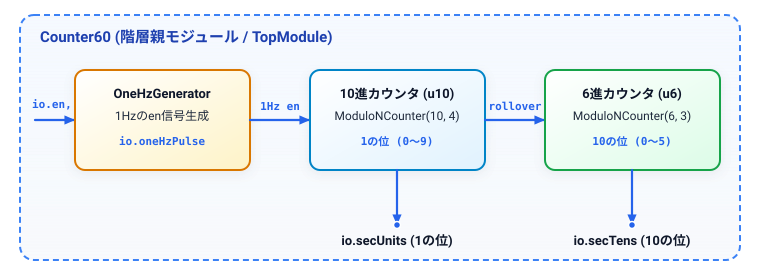
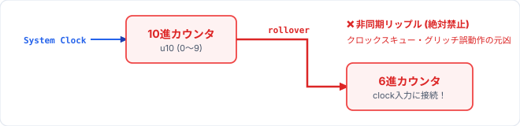
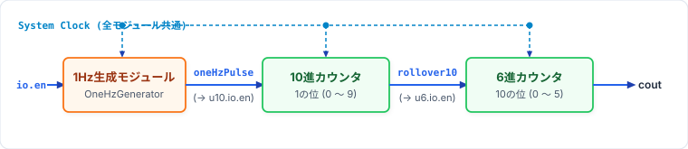
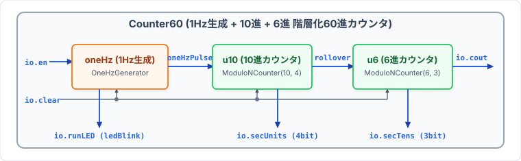
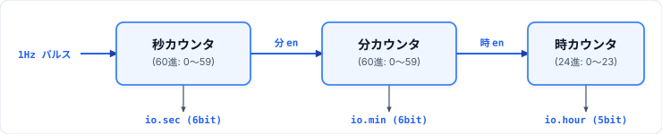

# 第5回: 60進カウンタの構造化設計
### 〜モジュール階層化設計・1Hzイネーブル生成・10進×6進同期カスケード〜

<br>

- **資料作成者**: Hideaki YANAGISAWA
- **講義時間**: 60分
- **対象**: デジタル論理回路基礎習得者
- **本日のアジェンダ**:
  1. 大規模ハードウェア設計と階層化設計 (Hierarchical Design)
  2. Chiselにおける階層化設計の作法（サブモジュール定義・インスタンス化・ポート結線）
  3. 60進カウンタの構成方針: 1Hz生成 + 10進カウンタ + 6進カウンタ
  4. **【最重要工学原則】非同期リップルクロックの完全排除**
  5. 単一グローバルクロックと**同期イネーブル伝播 (`oneHzPulse` / `rollover` $\to$ `en`)**
  6. 3つのサブモジュール（`OneHzGenerator`, 10進, 6進）の定義と協調動作
  7. 桁上げ同期パルスのタイミング検証
  8. 構造化60進カウンタ (`Counter60`) の完全実装
  9. 確認課題: 時・分・秒を統合した24時間デジタル時計コア
  10. 本日の演習課題（基本問題: 60進カウンタ / 確認課題: デジタル時計コア）

<!-- Note:
第5回の講義へようこそ。
本講義では、これまで学んできた単体モジュールを組み合わせてより実用的な回路を構築する「階層化設計（構造化設計）」を詳しく学びます。
その題材として、デジタル時計の心臓部である「60進カウンタ」を取り上げます。
今回の60進カウンタは、「1Hzのイネーブル信号を出すモジュール」「10進カウンタ（1の位）」「6進カウンタ（10の位）」の3つのサブモジュールを階層的に組み合わせて構成します。
ここで初心者が最も陥りやすい致命的な落とし穴が「非同期リップルクロック」です。なぜ非同期クロックがダメなのか、そして単一クロックで複数モジュールを同期連携させるプロの設計作法を徹底的に解説します。
-->

---

## 1. 階層化設計 (Hierarchical Design) とは何か？

### フラット設計（単一巨大モジュール）の限界
すべての回路（分周器・1の位・10の位のレジスタと条件分岐）を1つの `Module` 内にフラットに記述すると：
- 内部状態レジスタや制御信号が絡み合い、可読性・保守性が著しく低下する。
- 第3回で作った `OneHzGenerator` や `ModuloNCounter` といった既存資産を再利用できない。
- 部品ごとの単体テスト（Unit Test）が不可能になり、バグの特定が困難になる。

### 階層化設計による分割統治 (Divide and Conquer)
システムを明確な機能境界を持つ独立した**サブモジュール（子モジュール）**に分割し、**トップモジュール（親モジュール）**でそれらをインスタンス化して結線する設計手法。

<p align="center"></p>

<!-- Note:
階層化設計の必要性です。
もし60進カウンタを1つのモジュールにベタ書きしたら、9MHzを数える24ビットレジスタ、1の位の4ビットレジスタ、10の位の3ビットレジスタが1つのwhen文の中で複雑に絡み合ってしまいます。
しかし階層化設計を用いれば、「1Hzのen信号を作る部品」「10進カウンタ部品」「6進カウンタ部品」という独立した3つの箱に分け、トップモジュールではそれらを線で繋ぐだけで済みます。
-->

---

## 2. Chiselにおける階層化設計の3ステップ

Chiselで階層構造を構築する際は、以下の3つのステップで行います。

### Step 1: サブモジュール（部品）のクラス定義
各機能ブロックを `Module` を継承したクラスとして定義し、`io` バンドルで入出力ピンを宣言する。
### Step 2: 親モジュール内でのインスタンス化 (`Module(new ...)`)
親モジュールの中で **`val インスタンス名 = Module(new サブモジュール名(引数))`** を呼び出し、ハードウェア実体を配置する（※ `Module(...)` で囲むのを忘れないこと！）。
### Step 3: ポート間の結線 (`:=`)
- **親 $\to$ 子**: `child.io.in := io.in` （親の入力ピンを子の入力ピンへ接続）
- **子 $\to$ 子**: `childB.io.en := childA.io.out` （兄弟モジュール間の信号受け渡し）
- **子 $\to$ 親**: `io.out := child.io.out` （子の出力ピンを親の出力ピンへ接続）
- ※ **注意**: すべてのサブモジュールの `clock` と `reset` は、Chiselが裏側で自動的に親モジュールの単一クロック・リセットへ共通接続します。

<!-- Note:
Chiselにおける階層化設計の具体的な3ステップです。
特に重要なのがStep 2の Module(new ...) です。単に new SubModule と書いただけではScalaのオブジェクトが作られるだけで回路になりません。必ず Module(...) でラップします。
そしてStep 3では、親から子、子から子、子から親へと := 演算子でポート同士を配線します。
なお、クロック信号とリセット信号はChiselが自動的に全サブモジュールへ同一のものを分配してくれるため、手動でクロックを引き回す必要はありません。
-->

---

## 3. 階層化設計のコード記述パターン

```scala
// 【Step 1】サブモジュール（部品）の定義
class SubModule(val param: Int) extends Module {
  val io = IO(new Bundle {
    val en  = Input(Bool())
    val out = Output(UInt(4.W))
  })
  // 内部論理...
}

// 【Step 2 & 3】トップモジュール（親）でのインスタンス化と結線
class TopModule extends Module {
  val io = IO(new Bundle {
    val en  = Input(Bool())
    val res = Output(UInt(4.W))
  })
  val uSub = Module(new SubModule(10)) // Step 2: 実体化
  uSub.io.en := io.en                  // Step 3: 親の入力を子の入力へ
  io.res     := uSub.io.out            // Step 3: 子の出力を親の出力へ
}
```

- コンストラクタ引数（`param: Int`）を渡すことで、**同じクラス定義から異なる仕様（10進や6進、分周比など）のサブモジュールを自在に生成**できる。

<!-- Note:
階層化設計のコード例です。
SubModuleという1つの設計図（クラス）を作っておけば、TopModuleの中で Module(new SubModule(10)) や Module(new SubModule(6)) のように引数を変えて何度でも実体化できます。
ソフトウェアの関数呼び出しと似ていますが、ハードウェアでは呼び出した数だけ物理的な回路ブロックがチップ上に配置されます。
-->

---

## 4. 60進カウンタ (`Counter60`) の3モジュール階層構成

実機のシステムクロック（9MHz）から「1秒ごとに00〜59を数える60進カウンタ」を作るため、以下の**3つのサブモジュール**で階層化します。

1. **`OneHzGenerator`（1Hzの `en` 信号を出すモジュール）**:
   - システムクロック（9MHz）を分周し、1秒に1回、**1クロック幅だけ `true.B` になるパルス (`oneHzPulse`)** を生成する。
2. **`ModuloNCounter(10, 4)`（10進カウンタ: 秒の1の位 `0`〜`9`）**:
   - `OneHzGenerator` が出す1Hzパルスを `en` に受けて、1秒に1回カウントアップする。
3. **`ModuloNCounter(6, 3)`（6進カウンタ: 秒の10の位 `0`〜`5`）**:
   - 10進カウンタが `9` に達したときに出す桁上げパルス (`rollover`) を `en` に受けて、10秒に1回カウントアップする。

$$1\text{ Hz Pulse} \longrightarrow \underbrace{10\text{進 (0〜9)}}_{\text{1の位}} \times \underbrace{6\text{進 (0〜5)}}_{\text{10の位}} = 60\text{進カウンタ (00〜59秒)}$$

<!-- Note:
本日設計する60進カウンタの全体像です。
なぜ60進を1つのカウンタで作らずにこの3つのモジュールで構成するのでしょうか？
第1に、ボードのクロックは9MHzなので、そのまま数えると1秒間に900万回進んでしまいます。そこで1Hzのイネーブル信号を出す OneHzGenerator を初段に置きます。
第2に、7セグメントLED等に表示する際、0〜59の2進数を10で割って10の位と1の位に分解する除算回路は巨大になります。最初から10進カウンタと6進カウンタに分けておけば、割り算なしで直接1の位と10の位が得られます。
-->

---

## 5. 【最重要工学原則】非同期リップルクロックの絶対禁止

1Hz生成モジュールの出力や10進カウンタの桁上げ出力を、次段の**クロック入力 (`clk`)** に直接繋ぐ回路（リップルクロック）は**厳禁**です。

<p align="center">
  
</p>

<div class="box">
<b>なぜ非同期リップルクロックはダメなのか？</b><br>
1. <b>クロックスキューの累積</b>: 前段のフリップフロップ遅延が次段のクロック遅延となり、段数が増えるほど変化タイミングがズレる。<br>
2. <b>グリッチによる誤カウント</b>: 組み合わせ論理で作られた桁上げ信号のヒゲ（グリッチ）がクロックエッジと誤認され、余分にカウントアップする。<br>
3. <b>静的タイミング解析 (STA) の破綻</b>: 異なるクロックドメインが乱立し、FPGA/ASICツールでタイミング検証ができなくなる。
</div>

<!-- Note:
本講義で最も強く強調したいスライドです。
初心者が階層回路を描くとき、1Hz分周器の出力を10進カウンタのクロック端子に繋ぎ、10進カウンタの桁上げ出力を6進カウンタのクロック端子に繋いでしまいがちです。
これは「非同期リップルクロック」と呼ばれ、現代のデジタル回路設計では絶対に行ってはいけないアンチパターンです。
クロックが論理ゲートを通ることで遅延やヒゲ（グリッチ）が生じ、上位の桁が勝手に2回進んでしまうといった致命的な誤動作を引き起こします。
-->

---

## 6. 正しい設計原則: 単一クロックと同期イネーブル伝播

**3つのサブモジュールすべてに同一のシステムクロック（System Clock）を供給**し、1Hzパルスや桁上げパルスはすべて**イネーブル信号 (`en`)** として次段へ伝播させる。

<p align="center">
  
</p>

- **単一クロック駆動**: `OneHzGenerator`、10進カウンタ、6進カウンタの全フリップフロップが同一のクロック立ち上がりエッジで一斉に動作する。
- **同期イネーブル連鎖**: `oneHzPulse` が10進の `en` を制御し、10進の `rollover` が6進の `en` を制御する。

<!-- Note:
こちらが正しい同期設計のアーキテクチャです。
下の赤い線を見てください。システムクロック（9MHz）は、1Hz生成モジュールにも、10進カウンタにも、6進カウンタにも、全く同じものが直接入っています。
ではどうやって1秒に1回、あるいは10秒に1回だけ進めるのかというと、青と緑の線、すなわち「イネーブル端子（en）」を使います。
1Hz生成モジュールは1秒に1クロックだけHighになるパルスを出し、それを10進カウンタのenに入れます。さらに10進カウンタが9かつenのときに出すrolloverパルスを6進カウンタのenに入れます。
これにより、すべてのレジスタが同じクロックエッジで寸分の狂いもなく同時に更新されます。
-->

---

## 7. サブモジュール①: 1Hzの`en`信号を出すモジュール (`OneHzGenerator`)

第3回で作成した `OneHzGenerator` をサブモジュールとして配置します。

```scala
class OneHzGenerator(val clkFreq: Int = 9000000) extends Module {
  val io = IO(new Bundle {
    val en         = Input(Bool())
    val clear      = Input(Bool())
    val ledBlink   = Output(Bool())
    val oneHzPulse = Output(Bool()) // 1秒に1回、1クロック幅だけ true.B
  })
  val cntWidth = log2Ceil(clkFreq)
  val cntReg   = RegInit(0.U(cntWidth.W))
  val ledReg   = RegInit(false.B)

  when(io.clear) {
    cntReg := 0.U; ledReg := false.B
  }.elsewhen(io.en) {
    when(cntReg === (clkFreq - 1).U) {
      cntReg := 0.U; ledReg := !ledReg
    }.elsewhen(cntReg === (clkFreq / 2 - 1).U) {
      cntReg := cntReg + 1.U; ledReg := !ledReg
    }.otherwise { cntReg := cntReg + 1.U }
  }
  io.ledBlink   := ledReg
  io.oneHzPulse := io.en && (cntReg === (clkFreq - 1).U)
}
```

<!-- Note:
1つ目のサブモジュール、OneHzGeneratorです。
第3回で設計した通り、clkFreq（900万サイクル）を数え、最後の (clkFreq - 1) に達し、かつ外部の io.en が有効なときだけ、io.oneHzPulse に1クロック幅のHighパルスを出力します。
この oneHzPulse こそが、後段の10進カウンタを1秒に1回だけ動かすための「同期イネーブル信号」になります。
-->

---

## 8. サブモジュール②③: 10進・6進カウンタ (`ModuloNCounter`)

同じく第3回で作成した汎用 `ModuloNCounter` から、引数 `n` と `width` を変えて**10進カウンタ**と**6進カウンタ**を生成します。

```scala
class ModuloNCounter(val n: Int, val width: Int) extends Module {
  val io = IO(new Bundle {
    val en       = Input(Bool())
    val clear    = Input(Bool())
    val count    = Output(UInt(width.W))
    val rollover = Output(Bool()) // (cntReg === n-1) && io.en
  })
  val cntReg = RegInit(0.U(width.W))
  when(io.clear) {
    cntReg := 0.U
  }.elsewhen(io.en) {
    when(cntReg === (n - 1).U) { cntReg := 0.U }.otherwise { cntReg := cntReg + 1.U }
  }
  io.count    := cntReg
  io.rollover := io.en && (cntReg === (n - 1).U)
}
```

- **重要ポイント**: `io.rollover` の式に **`io.en && ...`** が含まれているため、10進カウンタの `cntReg` が `9` であっても、`oneHzPulse`（= `u10.io.en`）が来た**1クロック幅の間だけ** `u10.io.rollover` が `true.B` になる！

<!-- Note:
2つ目と3つ目のサブモジュールになる ModuloNCounter です。
n=10, width=4 を渡せば10進カウンタになり、n=6, width=3 を渡せば6進カウンタになります。
ここで18行目の io.rollover := io.en && (cntReg === (n - 1).U) に注目してください。
10進カウンタが「9」になってから次の1秒パルスが来るまでの約1秒間（8,999,999クロックの間）、cntRegはずっと9のままですが、u10.io.en（つまりoneHzPulse）はfalseです。
io.en と論理積をとっているおかげで、10進カウンタの rollover 出力も、1秒が経過して9から0に戻るその瞬間の「たった1クロック幅だけ」trueになります。だからそのまま6進カウンタの en に繋ぐことができるのです。
-->

---

## 9. 桁上げ同期パルスのタイミング検証

1Hzパルス (`oneHzPulse`) と10進桁上げ (`u10.rollover`) の同期タイミング波形：

```
Clock (9MHz):  _/~~\__/~~\__/~~\__/~~\__/~~\__/~~\__/~~\__/~~\_
oneHzPulse:    ________/‾‾‾‾‾‾‾‾\______________/‾‾‾‾‾‾‾‾\______ (1秒に1クロックだけHigh)
secUnits(10進): [  8  ]         │ [     9     ]         │ [ 0 ]
u10.rollover:  ________________________/‾‾‾‾‾‾‾‾\______ (9 かつ oneHzPulse の1クロック幅!)
secTens (6進):  [             0               ]         │ [ 1 ]
```

- `secUnits` が `9` になった直後は `oneHzPulse` が Low に戻るため、`u10.rollover` も Low のまま保たれる（6進カウンタが毎クロック暴走しない）。
- 1秒後に次の `oneHzPulse` が立ち上がった1クロックサイクルだけ `u10.rollover` が High になり、次のクロックエッジで **`secUnits` (9 $\to$ 0) と `secTens` (0 $\to$ 1) が同時に遷移**する。

<!-- Note:
このタイミングチャートは非常に重要です。ぜひじっくり見てください。
もし10進カウンタの rollover が単に (cntReg === 9.U) だけだったらどうなるでしょうか？
secUnitsが9である1秒間（900万クロックの間）ずっと6進カウンタのenがHighになり続け、6進カウンタが9MHzの猛スピードで何百万回も回転してしまいます。
そうならないのは、u10.rollover が「cntReg === 9.U かつ oneHzPulse」で作られているからです。
9秒目の最後の1クロックだけで u10.rollover がHighになり、次のクロックエッジで1の位が0、10の位が1へとピタリと同時遷移します。
-->

---

## 10. 構造化60進カウンタ (`Counter60`) のブロック構成

<p align="center">
  
</p>

### 3サブモジュール間の階層配線
1. **1Hz生成 (`oneHz`)**: `oneHz.io.en := io.en`, `oneHz.io.clear := io.clear`
2. **10進カウンタ (`u10`)**: `u10.io.en := oneHz.io.oneHzPulse`, `u10.io.clear := io.clear`
3. **6進カウンタ (`u6`)**: `u6.io.en := u10.io.rollover`, `u6.io.clear := io.clear`
4. **全体の桁上げ (`io.cout`)**: `u6.io.rollover`（59秒完了時の1クロックパルス）

<!-- Note:
Counter60 の全体ブロック図です。
Counter60という大きな箱の中に、OneHzGenerator、10進カウンタ(u10)、6進カウンタ(u6)の3つのサブモジュールが綺麗に並んでいます。
親の io.en は oneHz に入り、oneHz から出た oneHzPulse が u10 の en に入り、u10 から出た rollover が u6 の en に入り、u6 から出た rollover が親の io.cout として外に出ていきます。
まさにバケツリレーのように1クロック幅の同期イネーブルパルスが伝播していく美しい構造です。
-->

---

## 11. `Counter60` のChisel完全実装

```scala
class Counter60(val clkFreq: Int = 9000000) extends Module {
  val io = IO(new Bundle {
    val en       = Input(Bool())
    val clear    = Input(Bool())
    val secUnits = Output(UInt(4.W)) // 1の位 (0〜9)
    val secTens  = Output(UInt(3.W)) // 10の位 (0〜5)
    val cout     = Output(Bool())    // 59秒の最後の1クロックでアサート
  })

  // 1. 3つのサブモジュールをインスタンス化
  val oneHz = Module(new OneHzGenerator(clkFreq))
  val u10   = Module(new ModuloNCounter(10, 4)) // 10進カウンタ
  val u6    = Module(new ModuloNCounter(6, 3))  // 6進カウンタ

  // 2. 1Hz生成モジュールの配線
  oneHz.io.en    := io.en
  oneHz.io.clear := io.clear

  // 3. 10進カウンタの配線 (1Hzパルスでカウントアップ)
  u10.io.en    := oneHz.io.oneHzPulse
  u10.io.clear := io.clear

  // 4. 6進カウンタの配線 (10進の桁上げパルスでカウントアップ)
  u6.io.en    := u10.io.rollover
  u6.io.clear := io.clear

  // 5. 外部出力ポートへの接続
  io.secUnits := u10.io.count
  io.secTens  := u6.io.count
  io.cout     := u6.io.rollover
}
```

<!-- Note:
Counter60 のChisel実装コードです。
見ての通り、Counter60 自身の中には RegInit も when 文も1つもありません！
行っているのは、3つのサブモジュールを Module(new ...) で実体化し、それぞれの io ポートを := で結線しているだけです。
これが階層化設計の威力です。各部品の内部論理はカプセル化されており、トップモジュールは「どの部品とどの部品をどう繋ぐか」という構造（アーキテクチャ）だけに集中できます。
-->

---

## 12. 階層化設計におけるシミュレーションの工夫

### パラメータの階層引き渡し (`clkFreq`)
- 実機（9MHz）では1秒進めるのに **9,000,000 クロック**必要であり、そのまま60秒間シミュレーションすると $5.4 \times 10^8$ サイクルかかり長時間待たされる。
- `Counter60(val clkFreq: Int = 9000000)` のように親モジュールもパラメータを受け取り、子の `OneHzGenerator(clkFreq)` に引き渡す設計にしておけば：
  - **実機合成時**: `new Counter60()` （デフォルト9MHz）
  - **テスト時**: `new Counter60(clkFreq = 4)` （4クロック＝1秒として超高速検証！）

```scala
// テストベンチ側: clkFreq = 4 を指定してわずか240クロックで60秒分を完全検証！
test(new Counter60(clkFreq = 4)) { dut => ... }
```

<!-- Note:
階層化設計におけるテストのテクニックです。
実機用の900万分周のまま60秒分のテストベンチを回すと、5億4000万クロックもステップ実行することになり、テストが終わらなくなってしまいます。
そこで Counter60 のコンストラクタ引数として clkFreq を受け取り、それを内部の OneHzGenerator(clkFreq) にそのまま渡せるようにしておきます。
するとテストベンチでは new Counter60(clkFreq = 4) のように小さな値を指定でき、たった4クロックで1秒パルスが出るため、一瞬で00秒から59秒までの全遷移をテストできます。
-->

---

## 13. 発展設計: 24時間デジタル時計コア (`DigitalClockCore`)

カスケード構造をさらに多段に拡張し、時・分・秒を統合した時計システムを構築する。

<p align="center">
  
</p>

### カスケード連鎖の設計
- **秒カウンタ**: 1秒パルス `enSec` で動作（0〜59）。
- **分カウンタ**: 秒カウンタの桁上げをイネーブルに入力（0〜59）。
- **時カウンタ**: 秒桁上げと分桁上げの論理積で動作（0〜23）。

<!-- Note:
確認課題であるデジタル時計コアのアーキテクチャです。
秒モジュール（60進）、分モジュール（60進）、時モジュール（24進）が同じ同期イネーブル方式で数珠繋ぎになっています。
時カウンタが進む条件は「秒が59かつ分が59かつenSec」の瞬間です。
23時59分59秒の次の秒で、時計全体が 00:00:00 に同期クリアされます。
-->

---

## 14. モジュール階層化設計の3大原則

良いハードウェア階層化のための設計原則：

1. **高凝集・低結合 (High Cohesion, Low Coupling)**:
   - 1つのサブモジュールには1つの明確な役割（分周、10進計数、6進計数）だけを持たせ、モジュール間の配線（インターフェース）を最小限の信号（`en`, `clear`, `rollover`）に絞る。
2. **再利用性とパラメータ化 (Parametric Reusability)**:
   - `ModuloNCounter(n, width)` のように汎用パラメータを持たせ、同一の検証済みモジュールを複数箇所（10進・6進・24進）で使い回す。
3. **同期境界の一貫性 (Single Clock Domain)**:
   - 全階層で単一クロックを共有し、1クロック幅の同期イネーブルパルスでモジュール間の動作タイミングを調停する。

<!-- Note:
ハードウェア階層化設計のまとめとなる3大原則です。
1つ目は高凝集・低結合。役割を明確に分け、ピン数を最小限にします。
2つ目はパラメータ化による再利用。1つのModuloNCounterが10進にも6進にもなります。
3つ目は単一クロックと同期イネーブルの一貫性です。この3つを守ることで、どれほど大規模な回路になっても破綻せずに設計できます。
-->

---

## 15. 本日の演習課題 (90分)

演習は**基本問題**と**確認課題**の2段階構成です。

### 基本問題（必須 / 目安45〜50分）
- **`Counter60`**:
  - `OneHzGenerator(clkFreq)`、`ModuloNCounter(10, 4)`、`ModuloNCounter(6, 3)` の3つのサブモジュールをインスタンス化
  - `oneHzPulse` $\to$ 10進 `en`、10進 `rollover` $\to$ 6進 `en` の同期イネーブル接続
  - 1の位 (`secUnits`)、10の位 (`secTens`)、および60進桁上げ (`cout`) の出力

### 確認課題（推奨 / 目安30〜35分）
- **`DigitalClockCore`**:
  - 秒(60進)、分(60進)、時(24進)の3段同期カスケード結合
  - 23:59:59 $\to$ 00:00:00 の完全自動巡回動作の検証

### バッファ (5〜10分)
- コード整形、`sbt test` によるテスト実行、波形確認

<!-- Note:
演習の案内です。
まずは基本問題で、1Hz生成モジュール・10進カウンタ・6進カウンタの3つを階層結合した Counter60 を完成させましょう。
その後、確認課題で時・分・秒のデジタル時計コアに進んでください。
-->

---

## 16. 第5回 まとめ & 次回予告

### 本日の重要ポイント
1. **階層化設計**により、複雑な回路を独立したサブモジュールに分割し、トップモジュールでは `Module(new ...)` とポート結線 (`:=`) のみでクリーンに構築できる。
2. 60進カウンタは **1Hz生成モジュール (`OneHzGenerator`) + 10進カウンタ + 6進カウンタ** の3モジュール階層構成で実現する。
3. **非同期リップルクロックは厳禁**。全サブモジュールを単一クロックで駆動し、1クロック幅の**同期イネーブルパルス (`oneHzPulse`, `rollover`)** を次段の `en` に伝播させる。

### 次回予告: 第6回「構造化設計とALU」
- 構造化設計の本格的応用: プロセッサの計算中枢「算術論理演算ユニット (ALU)」
- 算術部 (`ArithmeticUnit`) と論理部 (`LogicUnit`) の機能分離設計
- クリティカルパスの分断: パイプラインレジスタ (`RegNext`) とステータスフラグ生成

<!-- Note:
第5回の講義は以上です。
階層化設計と同期イネーブル伝播の威力を実感できたでしょうか。
次回はこの構造化設計をさらに発展させて、コンピュータの頭脳であるALUを設計し、パイプライン化にも挑戦します。
それでは演習に移ります。Lab05のファイルを開いてください。
-->
