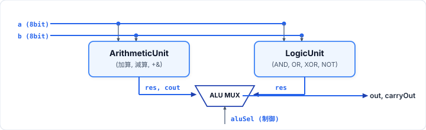
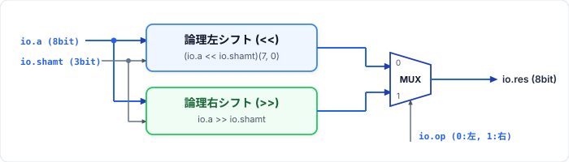
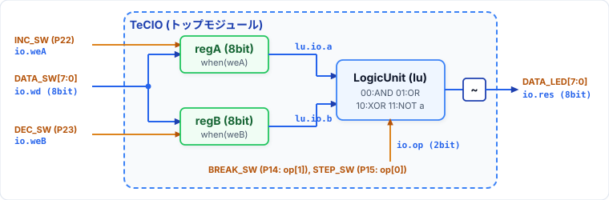

# 第6回: 構造化設計とALU 受講者配布資料
**授業名**: Computer System Laboratory | **資料作成者**: Hideaki YANAGISAWA | **講義**: 60分 / **演習**: 90分

---

## 1. 構造化（階層化）設計とALUの工学的原則

1. **分割統治 (Divide and Conquer)**:
   - 複雑な単一モジュール（フラット設計）はバグと保守性低下の温床となる。プロセッサの演算器（ALU）を設計する際は、機能ごとに独立したサブモジュール（算術・論理・シフト等）へ分割し、単体テストで検証した上で上位モジュールにて統合する。
2. **サブモジュールのインスタンス化と配線**:
   - インスタンス化: `val sub = Module(new SubModule())`
   - ポート配線: `sub.io.in := io.in`（入力供給）、`io.out := sub.io.out`（出力回収）

<p align="center">
  
</p>

### ステータスフラグ（Zero, Negative, Carry）の生成
- **Zeroフラグ (`Z`)**: `val zero = (io.out === 0.U)` （全ビットが `0` のとき `true.B`）
- **Negativeフラグ (`N`)**: `val negative = io.out(7)` （最上位ビットMSBが `1` のとき `true.B`）
- **Carryフラグ (`C`)**: `val carry = io.carryOut` （算術演算時の桁上げ／ボロー）

---

## 2. `assignment0`: TeCボード入出力回路 (`TeCIO`) の基礎確認

TeCボード上の8ビットデータ入力スイッチ（`DATA_SW[7:0]`）は1組しか存在しないため、2つの8ビット入力 `a`, `b` を必要とする演算器を実機で動作させるには、内部に2つの8ビットレジスタ **`regA`** と **`regB`** を設け、書き込みイネーブル信号（`weA`, `weB`）で順番にデータを保持させる必要がある。

```scala
class TeCIO extends Module {
  val io = IO(new Bundle {
    val wd  = Input(UInt(8.W)) // DATA_SW[7:0] (書き込みデータ)
    val op  = Input(Bool())    // 0 (false.B): regA出力, 1 (true.B): regB出力
    val weA = Input(Bool())    // INC_SW (regA 書き込みイネーブル)
    val weB = Input(Bool())    // DEC_SW (regB 書き込みイネーブル)
    val rd  = Output(UInt(8.W)) // DATA_LED[7:0]
  })
  val regA = RegInit(0.U(8.W))
  val regB = RegInit(0.U(8.W))

  when(io.weA) { regA := io.wd }
  when(io.weB) { regB := io.wd }

  io.rd := Mux(io.op, regB, regA)
}
```

- **動作確認 (`TeCIOtb.scala`)**:
  1. `wd = 10.U`, `weA = true.B` で `regA` に `10` を書き込み、`op = false.B` で `rd = 10` を確認。
  2. `wd = 200.U`, `weB = true.B` で `regB` に `200` を書き込み、`op = true.B` で `rd = 200` を確認。
  3. その後 `op` を切り替えることで、保持された `regA` (`10`) と `regB` (`200`) がそれぞれ読み出せることを確認する。

---

## 3. `assignment1`〜`assignment3`: 算術・論理・シフトユニット（シミュレーション動作確認）

`assignment1`〜`assignment3` の各演算ユニットは、それぞれのディレクトリで **`sbt test`（シミュレーション）により動作を確認**する。

### ① `assignment1`: 算術ユニット (`ArithmeticUnit.scala`)
8ビットの加算 (`ADD`) と減算 (`SUB`) を実行し、8ビット結果 `res` とキャリー／ボロー `cout` を出力する。**ビット幅拡張演算子 `+&` / `-&`** を用いて9ビットワイヤ `ext` に受け、下位8ビット `ext(7, 0)` と第8ビット `ext(8)` に分離する。

```scala
class ArithmeticUnit extends Module {
  val io = IO(new Bundle {
    val a    = Input(UInt(8.W))
    val b    = Input(UInt(8.W))
    val op   = Input(Bool()) // 0 (false.B): ADD, 1 (true.B): SUB
    val res  = Output(UInt(8.W))
    val cout = Output(Bool())
  })
  val ext = WireDefault(0.U(9.W))
  when(!io.op) { ext := io.a +& io.b }.otherwise { ext := io.a -& io.b }
  io.res  := ext(7, 0)
  io.cout := ext(8)
}
```

### ② `assignment2`: 論理ユニット (`LogicUnit.scala`)
ビット単位（Bitwise）の `AND`, `OR`, `XOR`, `NOT` を2ビット選択信号 `op` で切り替える。透過ラッチを防ぐため、`WireDefault(0.U(8.W))` で初期化したワイヤに対して `switch / is` で割り当てる。

```scala
class LogicUnit extends Module {
  val io = IO(new Bundle {
    val a   = Input(UInt(8.W))
    val b   = Input(UInt(8.W))
    val op  = Input(UInt(2.W)) // 0: AND, 1: OR, 2: XOR, 3: NOT a
    val res = Output(UInt(8.W))
  })
  val outW = WireDefault(0.U(8.W))
  switch(io.op) {
    is(0.U) { outW := io.a & io.b }
    is(1.U) { outW := io.a | io.b }
    is(2.U) { outW := io.a ^ io.b }
    is(3.U) { outW := ~io.a }
  }
  io.res := outW
}
```

### ③ `assignment3`: シフトユニット (`ShiftUnit.scala`)
8ビット入力 `a` を、3ビットのシフト量 `shamt`（0〜7ビット）だけ論理左シフト (`<<`) または論理右シフト (`>>`) する。Chiselの動的左シフト `io.a << io.shamt` は最大シフト時にも上位ビットが失われないよう結果幅が $8 + (2^3 - 1) = 15$ ビットへ自動拡張されるため、**`(io.a << io.shamt)(7, 0)`** で下位8ビットをスライスする。

<p align="center">
  
</p>

```scala
class ShiftUnit extends Module {
  val io = IO(new Bundle {
    val a     = Input(UInt(8.W))
    val shamt = Input(UInt(3.W)) // シフト量 (0〜7ビット)
    val op    = Input(Bool())    // 0 (false.B): 論理左シフト (<<), 1 (true.B): 論理右シフト (>>)
    val res   = Output(UInt(8.W))
  })
  val outW = WireDefault(0.U(8.W))
  when(!io.op) { outW := (io.a << io.shamt)(7, 0) }.otherwise { outW := io.a >> io.shamt }
  io.res := outW
}
```

---

## 4. 応用課題：`assignment2` のFPGAボード（TeCボード）上での動作確認

`assignment2` で作成した `LogicUnit` を、`TeCIO` モジュール内部でサブモジュールとしてインスタンス化（`val lu = Module(new LogicUnit())`）し、SystemVerilog を生成（`sbt run`）して **FPGAボード（TeCボード）上で実機動作を確認**する。

<p align="center">
  
</p>

```scala
class TeCIO extends Module {
  val io = IO(new Bundle {
    val wd  = Input(UInt(8.W))  // DATA_SW[7:0]: 書き込みデータ
    val op  = Input(UInt(2.W))  // BREAK_SW(op[1]), STEP_SW(op[0]): 2bit演算選択
    val weA = Input(Bool())     // INC_SW: regA 書き込み
    val weB = Input(Bool())     // DEC_SW: regB 書き込み
    val res = Output(UInt(8.W)) // DATA_LED[7:0]: 演算結果出力
  })
  val regA = RegInit(0.U(8.W))
  val regB = RegInit(0.U(8.W))

  when(io.weA) { regA := io.wd }
  when(io.weB) { regB := io.wd }

  val lu = Module(new LogicUnit())
  lu.io.op := io.op
  lu.io.a  := regA
  lu.io.b  := regB
  io.res   := ~lu.io.res // TeCボードのLED負論理に合わせて反転出力
}
```

### TeCボードのスイッチ・LED配線と操作方法 (`TeCIO.ucf`)

| ポート名 | TeCボード上のスイッチ・LED | FPGAピン番号 (`LOC`) | 役割・操作方法 |
| :--- | :--- | :--- | :--- |
| `clock` | `CLK_IN` | `P55` | システムクロック入力 |
| `reset` | **`RESET_SW`** | `P120` (`PULLUP`) | `regA`, `regB` のリセット |
| `io_wd[7:0]` | **`DATA_SW[7:0]`** | `P26, P27, P29, P30, P32, P33, P34, P35` (`PULLUP`) | **書き込みデータの用意**（8ビット） |
| `io_weA` | **`INC_SW`** | `P22` (`PULLUP`) | **`regA` にデータを書き込み** (`regA := io.wd`) |
| `io_weB` | **`DEC_SW`** | `P23` (`PULLUP`) | **`regB` にデータを書き込み** (`regB := io.wd`) |
| `io_op[1:0]` | **`BREAK_SW` (`op[1]`)**<br>**`STEP_SW` (`op[0]`)** | `P14` (`op[1]`, `PULLUP`)<br>`P15` (`op[0]`, `PULLUP`) | **2ビット `op` 演算選択**<br>（`00`: AND, `01`: OR, `10`: XOR, `11`: NOT a） |
| `io_res[7:0]` | **`DATA_LED[7:0]`** | `P81, P80, P79, P78, P62, P61, P59, P58` | **演算結果を `DATA_LED` へ出力** |

---

## 5. 本日の演習課題ガイドライン (90分)

演習コードは `Lab06/` 配下の各課題ディレクトリ（`assignment0`〜`assignment3`）に配置されています。

1. **導入確認 (`assignment0`)**: `TeCIO.scala` と `TeCIOtb.scala` を確認し、`sbt test` で `regA`, `regB` への書き込みと選択読み出しのシミュレーション動作を確認する。
2. **基本・発展課題 (`assignment1`〜`assignment3` / シミュレーション確認)**:
   - **`assignment1` (`ArithmeticUnit`)**: 算術ユニットを実装し、`sbt test` でパスすることを確認（シミュレーションのみ）。
   - **`assignment2` (`LogicUnit`)**: 論理ユニットを実装し、`sbt test` でパスすることを確認。
   - **`assignment3` (`ShiftUnit`)**: シフトユニットを実装し、`sbt test` でパスすることを確認（シミュレーションのみ）。
3. **応用課題 (`assignment2` / FPGAボード実機動作確認)**:
   - `assignment2` で `sbt run` を実行して `TeCIO.sv` を生成し、`TeCIO.ucf` を用いてFPGAボードへ書き込む。
   - **`DATA_SW`** でデータを用意 $\to$ **`INC_SW`** で `regA` に書き込み $\to$ **`DATA_SW`** で別データを用意 $\to$ **`DEC_SW`** で `regB` に書き込み $\to$ **`BREAK_SW`, `STEP_SW`** で2ビット `op` を切り替え、演算結果が **`DATA_LED`** に正しく出力されることを確認する。
