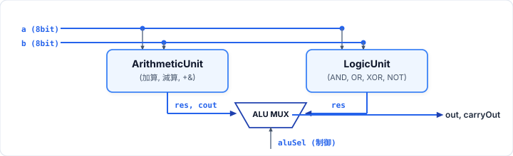
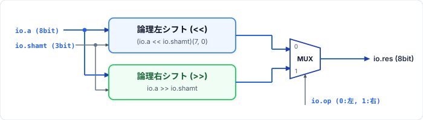
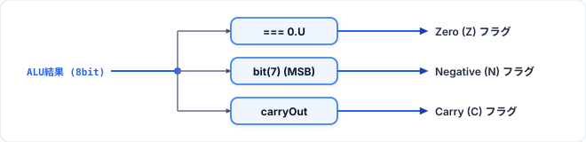

<!-- _class: lead -->

# Computer System Laboratory
## 第6回: 構造化設計とALU
### — 機能別ユニットの分割設計・階層統合・ステータスフラグ —

**授業構成**: 講義 60分 ／ 演習 90分

<!-- Note:
みなさんこんにちは。「Computer System Laboratory」第6回の講義を始めます。
前回（第5回）は、同一のモジュロNカウンタを複数インスタンス化して直列に繋ぐ「60進カウンタ」を学びました。
本日の第6回は、プロセッサの中核である「算術論理演算装置（ALU: Arithmetic Logic Unit）」をテーマに、異なる機能を持つサブモジュール（算術演算・論理演算・シフト演算）を分割設計し、階層的に統合する構造化設計手法を学びます。
-->

---

## 1. 本日のタイムテーブルと学習目標

<div class="columns">
<div>

### タイムテーブル（計150分）
| 時間 | パート | 内容 |
| :--- | :--- | :--- |
| **00:00 - 00:05** | 導入 | 第5回復習・フラット設計の限界 |
| **00:05 - 00:50** | 本論 | 算術・論理・シフトユニットと構造化ALU、ステータスフラグ |
| **00:50 - 01:00** | まとめ | 演習課題（3題）の仕様解説 |
| **01:00 - 02:30** | **演習** | **基本問題(2題 50分) + 発展問題(1題 35分)** |

</div>
<div>

### 本日の到達目標
1. 巨大化した単一モジュールを機能ごとのサブモジュールへ分割設計できる。
2. **算術ユニット (`ArithmeticUnit`)**・**論理ユニット (`LogicUnit`)**・**シフトユニット (`ShiftUnit`)** を正確に実装できる。
3. **構造化ALU (`StructuredALU`)** の階層接続と **ステータスフラグ（Zero, Negative, Carry）** の生成原理を理解する。

</div>
</div>

<!-- Note:
本日のゴールは3つです。
1つ目は、機能が異なる複数の演算器を独立したサブモジュールとして分割設計する方法。
2つ目は、ALUを構成する3つの基本演算ユニットである「算術演算」「論理演算」「シフト演算」をChiselで正確に記述する方法。
3つ目は、それらをトップモジュール（StructuredALU）で統合するアーキテクチャと、条件分岐の要となるステータスフラグ（Z, N, C）の生成回路の理解です。
-->

---

## 2. 前回（第5回）の復習と本日の位置づけ

### 第5回で学んだこと：反復的な階層化
- 同じクラス（`ModuloNCounter`）に異なるパラメータ（10進・6進）を与えて複数インスタンス化し、`rollover` $\to$ `en` で直列（カスケード）に接続した。

### 第6回で学ぶこと：機能分割による並列階層化（Divide and Conquer）
- プロセッサのデータパス（ALUなど）では、**役割の異なる複数の専用演算器**を並列に配置し、**マルチプレクサ（セレクタ）で出力を統合**する。

<div class="box-good">

**構造化設計の核心**: 「算術演算」「論理演算」「シフト演算」「トップレベルの出力選択」をそれぞれ独立したモジュールに分けることで、**単体テスト・デバッグ・機能拡張**が劇的に容易になる。
</div>

<!-- Note:
前回の60進カウンタは「同じカウンタを横に並べて桁上げを繋ぐ」という直列型の階層化でした。
一方、今回設計するALUは「算術演算器」「論理演算器」「シフト演算器」という全く中身が違う専門ユニットを並列に並べ、最後にセレクタで結果を選ぶ「並列・機能分割型」の階層化です。
-->

---

## 3. なぜフラット設計（単一巨大モジュール）は破綻するのか？

1つの `Module` 内に加算・減算・AND・OR・XOR・NOT・左右シフト・フラグ生成をすべて詰め込むと何が起きるか？

<div class="columns">
<div class="box-bad">

### フラット設計の悪夢
- 数十個の `when` / `switch` が絡み合い、信号の依存関係がスパゲッティ化する。
- 「バグが算術部にあるのか、シフト部にあるのか、セレクタにあるのか」切り分けできない。
- 複数人での分担開発が不可能。

</div>
<div class="box-good">

### 構造化（階層化）設計の利点
- **関心の分離**: 算術ユニットの設計者は加減算とキャリーだけに集中できる。
- **単体検証**: 各ユニット（算術・論理・シフト）を個別のテストベンチで100%検証してから統合できる。
- **再利用性**: 検証済みの演算ユニットを別のプロセッサ設計へそのまま流用できる。

</div>
</div>

<!-- Note:
もし1つの巨大なモジュールの中にすべての演算とフラグ回路を書いたらどうなるでしょうか。
コードが数百行に膨れ上がり、どこかでビット幅やラッチのミスが起きたときに原因を特定するのが非常に困難になります。
これに対し、機能ごとにモジュールを分割すれば、それぞれのユニットを単独でテスト（単体テスト）して完璧に動くことを確認してから組み立てることができます。本日の演習でも、この単体モジュール実装とテストを体験します。
-->

---

## 4. モジュール階層化とインスタンス化の構文

子モジュールを親モジュール内部で実体化するには **`Module(new 子クラス名)`** を用いる。

```scala
class TopModule extends Module {
  val io = IO(new Bundle { ... })

  // 1. サブモジュールのインスタンス化 (必ず Module(...) でラップする)
  val subA = Module(new SubModuleA())
  val subB = Module(new SubModuleB())

  // 2. 入力の供給: 親の入力を子の入力へ接続 (子.io.in := 親.io.in)
  subA.io.in := io.inA
  subB.io.in := subA.io.out // 子から子への内部接続

  // 3. 出力の回収: 子の出力を親の出力へ接続 (親.io.out := 子.io.out)
  io.out := subB.io.out
}
```

> **`clock` と `reset` は自動配線**: Chiselでは親モジュールの `clock` / `reset` がすべてのサブモジュールへ自動的に分配される。

<!-- Note:
前回も登場した Module(new ...) の構文を改めて整理しましょう。
ただの `new SubModuleA()` ではハードウェアとして実体化されません。必ず `Module(new SubModuleA())` で包みます。
そして、親から子へ信号を渡すときは `subA.io.in := io.inA`、子から親へ結果を受け取るときは `io.out := subB.io.out` のように、`io` バンドルを介して `:=` で結線します。
-->

---

## 5. 構造化ALU (`StructuredALU`) の全体アーキテクチャ

トップモジュール `StructuredALU` は、独立した演算サブモジュールを束ね、上位制御信号 `aluSel` で出力を選択する。

<p align="center">
  
</p>

- **機能分割**: 算術演算 (`ArithmeticUnit`) と 論理演算 (`LogicUnit`)（さらに拡張時はシフト演算 `ShiftUnit`）を並列に配置。
- **制御信号の階層分配**: 下位ビットを各ユニット内の演算選択 (`op`) に渡し、上位ビットをトップレベルのマルチプレクサ選択信号に使う。

<!-- Note:
構造化ALUの全体ブロック図です。
8ビット入力 a と b は、内部の各演算ユニットへ並列に分配されます。
各ユニットは同時に計算を行い、最後にトップレベルのマルチプレクサ（ALU MUX）が制御信号 aluSel に従って、どのユニットの計算結果を採用するかを選択して出力します。
-->

---

## 6. サブモジュール①：算術ユニット (`ArithmeticUnit`) — 課題1

8ビットの加算 (`ADD`) と減算 (`SUB`) を行い、**8ビット結果 `res`** と **キャリー／ボロー出力 `cout`** を生成する。

```scala
// 課題1 (assignment1): 算術ユニット
class ArithmeticUnit extends Module {
  val io = IO(new Bundle {
    val a    = Input(UInt(8.W))
    val b    = Input(UInt(8.W))
    val op   = Input(Bool()) // 0 (false.B): ADD, 1 (true.B): SUB
    val res  = Output(UInt(8.W))
    val cout = Output(Bool())
  })

  // 9ビット幅拡張演算 (+& / -&) により桁上げ(cout)と8ビット結果(res)を同時に取得
  val ext = WireDefault(0.U(9.W))
  when(!io.op) {
    ext := io.a +& io.b
  }.otherwise {
    ext := io.a -& io.b
  }
  io.res  := ext(7, 0) // 下位8ビット: 演算結果
  io.cout := ext(8)    // 最上位ビット(第8ビット): キャリー／ボロー出力
}
```

<!-- Note:
本日の演習の課題1（assignment1）となる算術ユニット `ArithmeticUnit` です。
ここでの最大のポイントは、第1回で学んだビット幅拡張演算子 `+&` と `-&` の活用です。
通常の `+` や `-` を使うと結果が8ビットに切り捨てられてしまい、8ビット目からあふれたキャリー（または減算時のボロー）が消えてしまいます。
そこで 9ビットのワイヤ `ext = WireDefault(0.U(9.W))` を用意し、`+&` / `-&` で9ビット結果を受け取ってから、下位8ビット `ext(7, 0)` を `io.res` に、最上位ビット `ext(8)` を `io.cout` にスライスして出力します。
-->

---

## 7. `+&` / `-&` におけるキャリーとボローの動作

なぜ `ext := io.a +& io.b` と `ext := io.a -& io.b` で `ext(8)` がキャリー／ボローになるのか？

| 演算モード (`op`) | 入力例 (`a`, `b`) | 9ビット拡張計算 (`ext`) | `res = ext(7, 0)` | `cout = ext(8)` | 意味 |
| :--- | :--- | :--- | :---: | :---: | :--- |
| **`false.B` (ADD)** | `10`, `20` | `0_0001_1110` (30) | `30` | `false.B` (`0`) | 桁上げなし |
| **`false.B` (ADD)** | `200`, `100` | `1_0010_1100` (300) | `44` | `true.B` (`1`) | **桁上げ（Carry）発生** |
| **`true.B` (SUB)** | `50`, `20` | `0_0001_1110` (30) | `30` | `false.B` (`0`) | 桁借りなし ($a \ge b$) |
| **`true.B` (SUB)** | `10`, `20` | `1_1111_0110` (-10) | `246` | `true.B` (`1`) | **桁借り（Borrow）発生 ($a < b$)** |

- **ポイント**: 無符号減算 $a - b$ において $a < b$ のとき、9ビット減算結果のMSB `ext(8)` は符号拡張により `1` となるため、そのまま**ボロー（桁借り）フラグ**として利用できる。

<!-- Note:
加算と減算の具体例を見てみましょう。
200 + 100 = 300 は8ビット（最大255）を超えるため、下位8ビットの `res` は 300 - 256 = 44 となり、9ビット目の `ext(8)` が `1`（true.B）になります。
また減算で 10 - 20 を計算すると、2の補数表現で 256 - 10 = 246 が下位8ビットに出力され、上位から借りてきたことを示す9ビット目の `ext(8)` が `1`（true.B）になります。この4パターンが課題1のテストベンチで検証されます。
-->

---

## 8. サブモジュール②：論理ユニット (`LogicUnit`) — 課題2

4種類のビット単位（Bitwise）論理演算を `op`（2ビット）で切り替える組合せ回路。

```scala
// 課題2 (assignment2): 論理ユニット (AND, OR, XOR, NOT)
class LogicUnit extends Module {
  val io = IO(new Bundle {
    val a   = Input(UInt(8.W))
    val b   = Input(UInt(8.W))
    val op  = Input(UInt(2.W)) // 0: AND, 1: OR, 2: XOR, 3: NOT a
    val res = Output(UInt(8.W))
  })

  // 透過ラッチ防止のため WireDefault で初期化し、switch/is で分岐
  val outW = WireDefault(0.U(8.W))
  switch(io.op) {
    is(0.U) { outW := io.a & io.b }
    is(1.U) { outW := io.a | io.b }
    is(2.U) { outW := io.a ^ io.b }
    is(3.U) { outW := ~io.a }
  }
  io.res := outW
}
```

<!-- Note:
続いて課題2（assignment2）となる論理ユニット `LogicUnit` です。
第2回で学んだ組合せ回路の鉄則通り、まず `val outW = WireDefault(0.U(8.W))` でデフォルト値を設定して透過ラッチを防止します。
その上で `switch(io.op)` を使い、`0.U` ならビットAND (`&`)、`1.U` ならビットOR (`|`)、`2.U` ならビットXOR (`^`)、`3.U` なら入力 `a` のビット反転 (`~io.a`) を出力します。
-->

---

## 9. サブモジュール③：シフトユニット (`ShiftUnit`) — 課題3

データを指定ビット数（`shamt`: Shift Amount）だけ左右へ移動させる**バレルシフタ（Barrel Shifter）**回路。

<p align="center">
  
</p>

- **なぜ `shamt` は3ビット (`UInt(3.W)`) なのか？**
  - 8ビットデータ (`UInt(8.W)`) に対する有効なシフト量は **0〜7ビットの8通り**（$2^3 = 8$）であるため、`shamt` は3ビット幅で指定する。
- **シフト演算の用途**: $2^k$ 倍の高速乗除算（`a << k` $= a \times 2^k$、`a >> k` $= \lfloor a / 2^k \rfloor$）、ビットフィールド抽出。

<!-- Note:
そして課題3（assignment3）で新たに実装するのが、シフトユニット `ShiftUnit` です。
カウンタの回では1クロックごとに1ビットずつずらす「シフトレジスタ（順序回路）」を学びましたが、ALU内部のシフタは、0〜7ビットの任意のシフト量を1サイクル（組合せ回路）で一気にずらす「バレルシフタ」です。
入力データが8ビットなので、シフト量 `shamt`（Shift Amount）は0〜7を表す3ビット（`UInt(3.W)`）となります。
-->

---

## 10. Chiselにおける動的シフト演算の注意点と実装 (`ShiftUnit.scala`)

Chiselの動的左シフト `io.a << io.shamt` は、**ビット落ちを防ぐため結果のビット幅が最大幅へ自動拡張**される仕様を持つ。

<div class="box-warn">

**動的左シフトのビット幅拡張**:
`io.a` (`8.W`) `<<` `io.shamt` (`3.W`: 最大7シフト) の結果幅は **$8 + (2^3 - 1) = 15$ ビット (`15.W`)** に拡張される！
8ビットALUの出力として得るには、**`(...)(7, 0)` で下位8ビットを明示的にスライス**する。
</div>

```scala
// 課題3 (assignment3): シフトユニット (論理左シフト・論理右シフト)
class ShiftUnit extends Module {
  val io = IO(new Bundle {
    val a     = Input(UInt(8.W))
    val shamt = Input(UInt(3.W)) // シフト量 (0〜7ビット)
    val op    = Input(Bool())    // 0 (false.B): 論理左シフト (<<), 1 (true.B): 論理右シフト (>>)
    val res   = Output(UInt(8.W))
  })
  val outW = WireDefault(0.U(8.W))
  when(!io.op) {
    outW := (io.a << io.shamt)(7, 0) // 15ビット拡張結果から下位8ビットを取得
  }.otherwise {
    outW := io.a >> io.shamt       // 論理右シフト (上位には0が補充される)
  }
  io.res := outW
}
```

<!-- Note:
Chiselでシフトユニットを実装する際、非常に重要な仕様があります。
Chiselでは `io.a << io.shamt` のように変数（UInt）で左シフトを行うと、最大の7ビット左シフトが起きても上位ビットが消えないよう、自動的に 8 + 7 = 15ビット幅のワイヤを生成します。
今回のシフトユニットは8ビット演算器ですので、あふれた上位ビットを切り捨てて下位8ビットだけを取り出すために `(io.a << io.shamt)(7, 0)` とスライスします。
一方、論理右シフト `io.a >> io.shamt` は上位に0が詰められ、8ビット幅以下に収まるためそのまま代入できます。
-->

---

## 11. シフト演算の動作例（テストベンチ検証ケース）

`ShiftUnit` の動作を2進数・16進数で確認しよう。

| 演算モード (`op`) | 入力 `a` | `shamt` | シフト前の2進数 (`a`) | シフト後の下位8ビット (`res`) | 16進結果 |
| :--- | :---: | :---: | :---: | :---: | :---: |
| **`false.B` (左 `<<`)** | `0x05` | `2.U` | `0000_0101` | `0001_0100` (下位に `00` 挿入) | **`0x14`** |
| **`false.B` (左 `<<`)** | `0xB4` | `3.U` | `1011_0100` | `1010_0000` (上位3bit切り捨て) | **`0xA0`** |
| **`true.B` (右 `>>`)** | `0xB4` | `2.U` | `1011_0100` | `0010_1101` (上位に `00` 挿入) | **`0x2D`** |
| **`true.B` (右 `>>`)** | `0xA5` | `0.U` | `1010_0101` | `1010_0101` (変化なし) | **`0xA5`** |

<!-- Note:
課題3のテストベンチ（ShiftUnittb.scala）でチェックする4つのケースです。
特に2つ目のケース `0xB4 << 3` に注目してください。
2進数 `1011_0100` を左に3ビットずらすと、上位の `101` が8ビット枠から外れて切り捨てられ、残った `1_0100` の右側に `000` が入って `1010_0000`（`0xA0`）になります。
また3つ目の `0xB4 >> 2` では、論理右シフトなので右側の `00` が押し出され、左側から `00` が補充されて `0010_1101`（`0x2D`）になります。
-->

---

## 12. トップモジュール：構造化ALU (`StructuredALU`) の統合実装

分割設計したサブモジュールを `Module(new ...)` でインスタンス化し、上位モジュールで統合する。

```scala
class StructuredALU extends Module {
  val io = IO(new Bundle {
    val a        = Input(UInt(8.W))
    val b        = Input(UInt(8.W))
    val aluSel   = Input(UInt(3.W)) // bit[2]: 0=算術, 1=論理
    val out      = Output(UInt(8.W))
    val carryOut = Output(Bool())
  })
  // 1. 各サブモジュールのインスタンス化
  val arithUnit = Module(new ArithmeticUnit)
  val logicUnit = Module(new LogicUnit)

  // 2. 入力信号と下位制御ビットの配線
  arithUnit.io.a := io.a; arithUnit.io.b := io.b; arithUnit.io.op := io.aluSel(0)
  logicUnit.io.a := io.a; logicUnit.io.b := io.b; logicUnit.io.op := io.aluSel(1, 0)

  // 3. 最上位ビット aluSel(2) による出力選択 (MUX)
  io.out      := Mux(io.aluSel(2) === 0.U, arithUnit.io.res,  logicUnit.io.res)
  io.carryOut := Mux(io.aluSel(2) === 0.U, arithUnit.io.cout, false.B)
}
```

<!-- Note:
各演算ユニットが完成したら、トップモジュール `StructuredALU` の実装は驚くほどシンプルになります。
`Module(new ArithmeticUnit)` と `Module(new LogicUnit)` でインスタンスを作り、入力 `a`, `b` と選択信号の下位ビットを繋ぎます。
そして出力は `io.aluSel(2)`（最上位ビット）を見て、`0` なら算術ユニットの結果、`1` なら論理ユニットの結果を `Mux` で選ぶだけです。
論理演算が選ばれているときはキャリーは意味を持たないため、`io.carryOut` には `false.B` を出力します。
もしここにシフトユニット `ShiftUnit` も加える場合は、`aluSel` の上位ビットで3入力の `MuxLookup` や `switch` に拡張するだけで簡単に組み込めます。
-->

---

## 13. ステータスフラグの生成回路（Zero, Negative, Carry）

CPUが条件分岐命令（`BEQ`, `BLT`, `BGEU` など）を実行するために、ALUは演算結果の性質を表す**ステータスフラグ**を出力する。

<p align="center">
  
</p>

| フラグ名 | 記号 | 論理条件（8ビット出力 `out` の場合） | Chisel記述 |
| :--- | :---: | :--- | :--- |
| **Zero (ゼロ)** | **Z** | 全ビットが `0` のとき `true.B` | `io.zero := (out === 0.U)` |
| **Negative (負)** | **N** | 最上位ビット(MSB)が `1` のとき `true.B` | `io.negative := out(7)` |
| **Carry (桁上げ)** | **C** | 算術演算で第8ビットへの桁上げ／ボロー発生 | `io.carry := rawCout` |

<!-- Note:
プロセッサのALUには、計算結果のデータだけでなく「ステータスフラグ」という1ビットの出力群が備わっています。
例えばプログラムの `if (a == b)` を判定するとき、CPUはALUで `a - b` を計算し、結果が0になったことを示す **Zeroフラグ (Z)** が `1` かどうかでジャンプ先を決めます。
Chiselでは、8ビット結果 `out` に対して `out === 0.U` でZeroフラグ、最上位ビット `out(7)` の抽出で2の補数表現におけるNegative（負数）フラグ、そして算術ユニットの `cout`（論理演算時は `false.B` にマスク）でCarryフラグを、それぞれ1行の組合せ回路として生成できます。
-->

---

## 14. 階層化ALU設計のベストプラクティスまとめ

<div class="box-good">

### 構造化データパス設計 4つの鉄則
1. **1モジュール・1責務**: 算術 (`ArithmeticUnit`)、論理 (`LogicUnit`)、シフト (`ShiftUnit`)、統合 (`StructuredALU`) を明確に分離する。
2. **ビット幅境界の明示**:
   - 加減算の桁上げ抽出には **`+&` / `-&` と9ビットワイヤ**を用いる。
   - 動的左シフト `<<` では拡張されたビット幅から **`(7, 0)` で下位8ビットをスライス**する。
3. **透過ラッチの完全防止**: `switch` や `when` で分岐する組合せ回路の内部ワイヤには必ず **`WireDefault(0.U(...))`** を適用する。
4. **不要フラグのマスク**: 算術演算以外（論理演算・シフト演算）が選択されている時は、`carryOut` を `false.B` にマスクして誤動作を防ぐ。

</div>

<!-- Note:
本日の設計原則のまとめです。
特に2番の「ビット幅境界の明示」はChiselならではの重要ポイントです。
算術ユニットでは `+&` / `-&` で9ビットに広げてから `ext(7, 0)` と `ext(8)` に分けること、シフトユニットでは `(io.a << io.shamt)(7, 0)` で8ビット幅に切り出すこと、この2つをしっかり押さえておきましょう。
-->

---

## 15. 本日の演習課題 (90分) — `Lab06`

本日の演習では、ALUを構成する3つの基本演算ユニットをそれぞれ独立したモジュールとして実装し、単体テスト (`sbt test`) で検証します。

| 課題フォルダ | モジュール名 | 入出力仕様 | 実装のポイント |
| :--- | :--- | :--- | :--- |
| **`assignment1`**<br>（必須・30分） | **`ArithmeticUnit`**<br>（算術ユニット） | 入力: `a(8.W)`, `b(8.W)`, `op(Bool)`<br>出力: `res(8.W)`, `cout(Bool)` | `op=0`: 加算 (`+&`), `op=1`: 減算 (`-&`)<br>9ビット結果から `ext(7,0)` と `ext(8)` を分離 |
| **`assignment2`**<br>（必須・25分） | **`LogicUnit`**<br>（論理ユニット） | 入力: `a(8.W)`, `b(8.W)`, `op(2.W)`<br>出力: `res(8.W)` | `WireDefault` + `switch(io.op)`<br>`0`: AND, `1`: OR, `2`: XOR, `3`: NOT `a` |
| **`assignment3`**<br>（発展・30分） | **`ShiftUnit`**<br>（シフトユニット） | 入力: `a(8.W)`, `shamt(3.W)`, `op(Bool)`<br>出力: `res(8.W)` | `op=0`: 論理左シフト `(io.a << io.shamt)(7, 0)`<br>`op=1`: 論理右シフト `io.a >> io.shamt` |

- **検証手順**: 各フォルダ（`assignment1`〜`assignment3`）で `sbt test` を実行し、`All tests passed.` を確認してください。

<!-- Note:
本日の演習課題は3つに分かれています。
assignment1 は算術ユニット `ArithmeticUnit`、assignment2 は論理ユニット `LogicUnit`、assignment3 はシフトユニット `ShiftUnit` です。
それぞれのフォルダにテストベンチ（ArithmeticUnittb.scala, LogicUnittb.scala, ShiftUnittb.scala）が用意されていますので、各フォルダで `sbt test` を実行して全テストケースにパスすることを確認してください。
-->

---

## 16. 第6回 まとめ & 次回予告

### 本日の重要ポイント
1. 大規模な組合せ回路（ALU）は、**算術・論理・シフト**の各機能サブモジュールに分割して設計・単体検証する。
2. 算術演算では **`+&` / `-&`** で9ビット拡張し、下位8ビット (`res`) とキャリー (`cout`) を抽出する。
3. 論理演算では **`WireDefault` と `switch/is`** で透過ラッチを防ぎつつ4演算を切り替える。
4. 動的左シフトではビット幅拡張に対応するため **`(io.a << io.shamt)(7, 0)`** で下位8ビットをスライスする。
5. 演算結果から **Zero (`out === 0.U`)・Negative (`out(7)`)・Carry** のステータスフラグを生成できる。

### 次回予告: 第7回「有限状態機械（FSM）の設計」
- `ChiselEnum` を用いた型安全な状態定義と Moore型FSM による制御回路設計

<!-- Note:
第6回の講義は以上です。
データパスの花形であるALUの内部構造と3つの演算ユニットの作り方が理解できたと思います。
次回第7回は、こうしたデータパスを順番に制御する頭脳となる「有限状態機械（FSM）」を学びます。
それでは演習を開始してください！
-->
