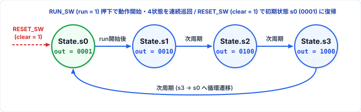

# 第7回: 有限状態機械 (FSM) 受講者配布資料
**授業名**: Computer System Laboratory | **資料作成者**: Hideaki YANAGISAWA | **講義**: 60分 / **演習**: 90分

---

## 1. 有限状態機械の工学的原則

1. **有限状態機械 (FSM: Finite State Machine)**:
   - システムの過去の履歴を有限個の「状態（State）」としてレジスタに記憶し、入力と現在の状態に基づいて「次状態」および「出力」を決定する逐次制御回路。

2. **Moore型 vs Mealy型 の本質的差異**:
   - **Mealy型**: 出力 $Y = f(\text{State}, \text{Input})$
     - 出力が現在の入力に直接依存するため、状態遷移を待たずに即時応答できるが、入力信号に含まれる**過渡的なノイズ（グリッチ）が出力へ直通（フィードスルー）**してしまう重大な欠点がある。
   - **Moore型（本講義推奨）**: 出力 $Y = f(\text{State})$
     - 出力は**状態レジスタの値のみから生成**される。
     - 入力側の組合せ論理と出力が完全にレジスタで遮断されるため、**グリッチフリーで極めて高い耐ノイズ性**を実現できる。

```
【Moore型 FSM (推奨: グリッチフリー)】
Input ---> [次状態論理] ---> [状態レジスタ] ---> [出力論理] ---> Output
                 ^                    |
                 +--------------------+
```

---

## 2. Chisel における型安全な状態モデリング (`ChiselEnum`)

状態を整数（0, 1, 2...）で直接扱うと、状態の重複や未定義値の代入などバグの原因になります。  
Chiselでは `ChiselEnum` を用いて型安全な列挙型状態を定義します。

```scala
object State extends ChiselEnum {
  val s0, s1, s2, s3 = Value
}
val stateReg = RegInit(State.s0) // 初期状態 s0 で同期リセット
```

---

## 3. 本日の演習課題仕様 (`assignment1`〜`assignment3`)

### 1. `assignment1`: 4状態を遷移し続けるFSM (`FourStateFSM.scala` & `TeCIO.scala`)
- **モジュール構成**:
  - **`FourStateFSM`**: `ChiselEnum` による 4状態 (`s0`, `s1`, `s2`, `s3`) を持ち、`clear` で初期状態 `s0`、`en` で `s0 -> s1 -> s2 -> s3 -> s0` と遷移し続け、状態を4ビットの**ワンホット（`"b0001".U`, `"b0010".U`, `"b0100".U`, `"b1000".U`）**として `io.out` に出力する。
  - **`TeCIO`**: `OneHzGenerator(clkFreq)` と `FourStateFSM` を呼び出し、**`OneHzGenerator` が生成する1秒パルス (`oneHzPulse`) をイネーブル信号 (`fsm.io.en`) として `FourStateFSM` を動作**させる。
- **TeCボード配線 (`TeCIO.ucf`)**:
  - `io_en`: `RUN_SW` (`P16` | `PULLUP`) — ランボタンで動作開始
  - `io_clear`: `RESET_SW` (`P120` | `PULLUP`) — リセットスイッチで初期状態 `s0` へ復帰
  - `io_runLED`: `RUN_LED` (`P43`) — 0.5秒ごとに点滅 (`~oneHz.io.ledBlink`)
  - `io_out[3:0]`: `DATA_LED[3:0]` (`P62, P61, P59, P58`) — ワンホット状態出力 (`~fsm.io.out`)

<p align="center">
  
</p>

```scala
class TeCIO(val clkFreq: Int = 9000000) extends Module {
  val io = IO(new Bundle {
    val en     = Input(Bool())     // RUN_SW (P16)
    val clear  = Input(Bool())     // RESET_SW (P120)
    val runLED = Output(Bool())    // RUN_LED (P43)
    val out    = Output(UInt(4.W)) // DATA_LED[3:0] (P62, P61, P59, P58)
  })
  val oneHz = Module(new OneHzGenerator(clkFreq))
  val fsm   = Module(new FourStateFSM)

  oneHz.io.en    := io.en
  oneHz.io.clear := io.clear
  fsm.io.en      := oneHz.io.oneHzPulse // 1秒パルスをFSMのイネーブル信号に入力
  fsm.io.clear   := io.clear

  io.runLED := ~oneHz.io.ledBlink
  io.out    := ~fsm.io.out
}
```

### 2. `assignment2`: Moore型 "101" パターン検出器 (`SequenceDetector101`)
- **状態定義**: `ChiselEnum` による 4状態 (`sIDLE`, `s1`, `s10`, `s101`)
- **入力**: `in` (Bool) | **出力**: `detected` (Bool)
- **論理仕様**:
  - Moore型設計（出力は `stateReg === State.s101` のみから生成）。
  - 入力ストリーム `1 -> 0 -> 1 -> 0 -> 1` のような**重複系列（"10101" $\to$ 2回アサート）**を正確に検出するため、`s101` 状態で `in === false.B` のときは `s10`、`in === true.B` のときは `s1` へ遷移させる。

```scala
switch(stateReg) {
  is(State.sIDLE) { when(io.in)  { stateReg := State.s1 } }
  is(State.s1)    { when(!io.in) { stateReg := State.s10 } }
  is(State.s10)   { when(io.in)  { stateReg := State.s101 }.otherwise { stateReg := State.sIDLE } }
  is(State.s101)  { when(io.in)  { stateReg := State.s1   }.otherwise { stateReg := State.s10 } }
}
io.detected := (stateReg === State.s101)
```

### 3. `assignment3`: 歩行者割り込み付き 交通信号機コントローラ (`TrafficLightController`)
- **状態定義**: `ChiselEnum` による 4状態 (`sVehGreen`, `sVehYellow`, `sVehRedPedGreen`, `sVehRedPedYellow`)
- **入力**: `pedestrianButton` (Bool)
- **出力**: `mainLight` (UInt(2.W): 0=Green, 1=Yellow, 2=Red), `pedLight` (Bool: 0=Red, 1=Green)
- **論理仕様**:
  - 歩行者ボタン入力をラッチするリクエストフラグ (`pedReqReg`) と内部タイマ (`timerReg`) を連動させ、車道青 $\to$ 車道黄 $\to$ 車道赤/歩行者青 $\to$ 車道赤/歩行者黄(赤) $\to$ 車道青 へと安全に遷移するMoore型FSM。

---

## 4. 本日の演習課題ガイドライン (90分)

演習コードは `Lab07/` 配下の各課題ディレクトリ（`assignment1`〜`assignment3`）に配置されています。

1. **基本問題1 (`assignment1`: `FourStateFSM` & `TeCIO`)**:
   - `FourStateFSM.scala` を実装して `sbt test` で単体検証したのち、`TeCIO.scala` で `OneHzGenerator` と `FourStateFSM` を接続し、`sbt run` で生成した回路を `TeCIO.ucf` を用いてFPGAボード（TeCボード）上で動作確認する。
2. **基本問題2 (`assignment2`: `SequenceDetector101`)**:
   - `ChiselEnum` 状態定義と重複系列（`"10101"`）に対応したMoore型FSMを実装し、`sbt test` で検証する。
3. **発展問題 (`assignment3`: `TrafficLightController`)**:
   - 歩行者ボタン押下のラッチ回路と内部タイマを連動させた4状態信号機FSMを実装し、`sbt test` で検証する。
